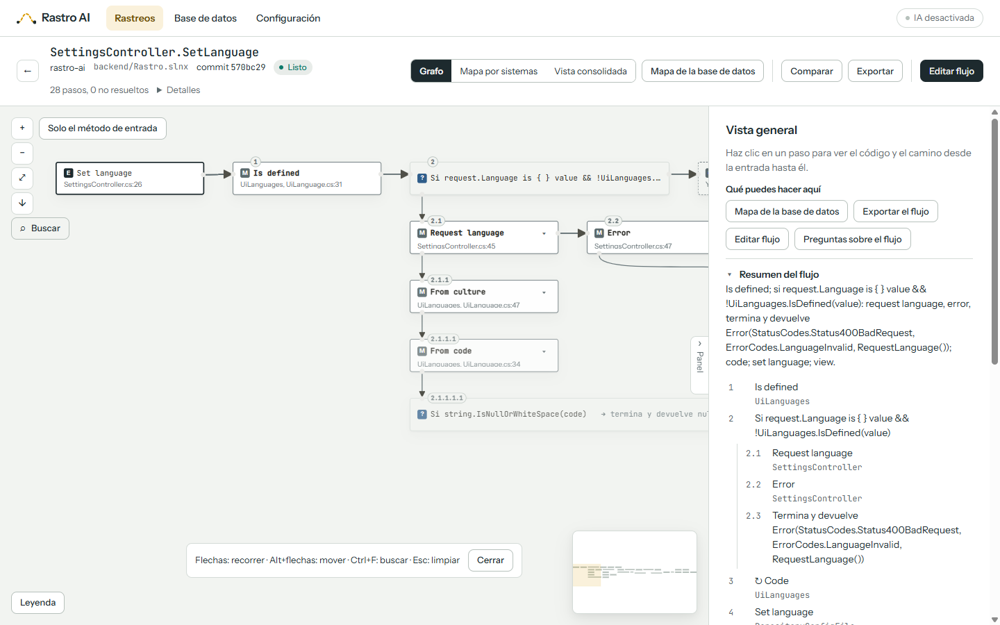

# Rastro AI

[English](README.md) · [Português](README.pt-BR.md) · **Español**

[](https://www.nuget.org/packages/rastro-ai)
[](https://github.com/felipemarcianodev/rastro-ai/actions/workflows/pr.yml)
[](LICENSE)

Rastro sigue el rastro de una funcionalidad en tu código .NET, desde la entrada (controller, job, handler) hasta el final (o desde el clic en una pantalla Angular hasta el controller), con cada decisión, cada bucle y la implementación real detrás de cada interfaz del DI. Muestra el flujo como un grafo que se lee de un vistazo y genera el prompt exacto para que la IA modifique ese punto.

Rastro se ejecuta solo en tu máquina: el código analizado nunca sale de ella. Funciona sin IA; con IA, ella solo propone, y quien confirma eres tú.

- **Línea de tiempo del método:** los pasos en el orden del código, numerados (1, 2, 2.1), con lo que llama cada método dibujado como una rama. Tres dibujos (horizontal, vertical y árbol), con la misma regla.
- **También para quien no programa:** los comandos aparecen en lenguaje natural ("Si ...", "Para cada ... en ..."), con el nombre legible del método y una etiqueta de lo que hace el paso en el mundo (base de datos, mensaje, caché, archivo, cola). Un resumen en una frase abre la vista general.
- **Prueba del compilador:** cada enlace muestra su origen (extraído del código, inferido por la IA o confirmado por ti). Lo que la IA propone pasa por Roslyn antes de entrar.
- **Entre sistemas:** el rastreo sigue la llamada HTTP de una API .NET a otra registrada en Rastro, con las bifurcaciones de cada sistema en el mismo dibujo.
- **De la pantalla al gateway:** el rastreo puede comenzar en un componente Angular (opcional, requiere Node), y el clic en el botón llega al controller y a las APIs siguientes.
- **Vista consolidada:** el flujo resumido en pocos pasos de lectura de negocio, en Mermaid editable, con los colores que elijas.
- **Mapa del flujo:** el nivel de un diagrama C2, con un carril por sistema, pocos bloques en cada uno, las decisiones que cambian el desenlace, las llamadas entre sistemas (verbo, ruta y campos enviados) y, en la API y en el MCP, los caminos de punta a punta. Los sistemas más allá del segundo salto vienen contraídos y se abren al hacer clic, y al hacer clic en el desenlace de una decisión se ilumina su camino.
- **Reglas y preguntas:** las decisiones se convierten en reglas en frases (bloquea, permite, efecto secundario), con la fuente en el código, y Rastro responde las preguntas ya preparadas de quien revisa (TL, Staff, gerente). Con IA activada, también la pregunta libre, siempre con las fuentes verificadas.
- **Esquema de la base de datos desde el código:** tablas, columnas, claves, índices, vistas y procedimientos leídos del modelo de EF Core, de las migrations y de los `.sql` (SQL Server y PostgreSQL, el dialecto sale del repositorio), con la fuente de cada elemento y la discrepancia entre fuentes marcada. Sin conectarse a ninguna base de datos y sin leer datos. En la pantalla "Mapa de la base de datos" de cada repositorio, en la API y en el MCP.
- **Análisis de consulta sin IA:** pega una consulta SQL (o abre la de un paso del flujo) y Rastro señala los cuellos de botella por gravedad, con el fragmento marcado y el motivo, cruzando con el esquema: `SELECT *`, función en la columna del filtro, `LIKE '%...'` (e `ILIKE` en PostgreSQL), conversión con `::`, columna sin índice, join sin condición y otros. La consulta no se ejecuta.
- **Cambio dibujado en el grafo:** tú editas el flujo, Rastro genera el prompt del cambio y, después de que el agente lo aplica, valida contra el código nuevo (compilación, pruebas y el flujo otra vez).
- **Arquitectura:** exporta el flujo en Mermaid, SVG y draw.io (`.drawio`) y la arquitectura en C4 (Structurizr), y señala mejoras y deuda técnica (DDD, código limpio, métricas).



## Instalar y usar

Requiere el SDK de .NET 10 (Rastro carga tu solution con el MSBuild de ese SDK). **Node** (20 o más reciente) es opcional: solo hace falta para rastrear flujos Angular (consulta la sección correspondiente). El paquete está en NuGet: [`rastro-ai`](https://www.nuget.org/packages/rastro-ai).

```bash
dotnet tool install -g rastro-ai
rastro                      # abre la ventana de Rastro; la pantalla también queda en http://127.0.0.1:7450 (solo en esta máquina; --porta lo cambia)
rastro --sem-janela         # solo la consola y la dirección, para abrir en el navegador
```

`rastro` se abre en su propia ventana, como una aplicación ([ADR-007](docs/adr/adr-007-janela-propria.md)). Cerrar la ventana cierra Rastro. La pantalla sigue disponible en el navegador, en la misma dirección, al mismo tiempo. En la ventana, el campo de la carpeta del repositorio incluye el botón "Examinar…", que abre el cuadro "Elegir carpeta" del sistema. La ventana usa el WebView del sistema:
- **Windows:** el WebView2 Runtime, que ya viene en Windows 11 y en las versiones actuales de Windows 10 (si no, [descárgalo de Microsoft](https://developer.microsoft.com/microsoft-edge/webview2/));
- **Linux:** `libwebkit2gtk-4.1` (en Ubuntu y Debian, `sudo apt install libwebkit2gtk-4.1-0`) y una sesión con pantalla;
- **macOS:** no hay nada que instalar.

Sin eso, Rastro avisa en la consola, sigue en marcha y muestra la dirección para abrir en el navegador.

Si Rastro ya está abierto en ese puerto, el comando solo muestra la dirección y termina. Si otro programa lo está usando, te pide que elijas otro con `--porta`.

Para actualizar o desinstalar, detén `rastro` antes (en Windows, el ejecutable en uso no se puede reemplazar):

```bash
dotnet tool update -g rastro-ai
dotnet tool uninstall -g rastro-ai
```

Registra tus repositorios en Configuración (en el encabezado de la pantalla) o desde la terminal. Los comandos de compilación y de pruebas, usados en la validación de un cambio, se editan en Configuración, en "Editar compilación y pruebas" de cada repositorio, o se indican al registrar desde la terminal:

```bash
rastro repo add minha-api C:\codigo\minha-api --build "dotnet build MinhaApi.slnx" --testes "dotnet test MinhaApi.slnx --no-build"
```

| Comando | Qué hace |
|---|---|
| `rastro` | Inicia la pantalla (API y front embebidos), solo en `127.0.0.1`, y abre la ventana propia |
| `rastro --sem-janela` | Inicia la pantalla sin abrir la ventana (solo el navegador). Alias en inglés: `--no-window` |
| `rastro repo add/remove/list` | Repositorios que Rastro puede leer (`~/.rastro/config.json`) |
| `rastro mcp` | Servidor MCP para tu agente de IA |

Los nombres de los comandos y de las opciones (`rastro repo add`, `--build`, `--testes`, `--sem-janela`, `--porta`) son una interfaz estable y no cambian con el idioma. Para quien prefiere inglés, también valen los alias `--tests`, `--no-window` y `--port`, junto a los nombres en portugués. La ayuda (`rastro --help`) y los mensajes de la terminal salen en el idioma del `config.json`.

Los datos quedan en `~/.rastro` (la base de datos SQLite `rastro.db`, el `config.json` y, después de la primera ventana, `janela/` con la caché del WebView); la variable `RASTRO_HOME` cambia la carpeta.

### Idioma

Rastro habla inglés, portugués de Brasil y español. El idioma vale para la pantalla, la API, la CLI y el MCP, y se elige en Configuración, en Apariencia. La elección se guarda en el `config.json` (`Rastro:Language`, con `en-US`, `pt-BR` o `es`); sin ella, vale el idioma del sistema operativo, con el inglés como respaldo cuando el sistema está en otro idioma. La pantalla envía el idioma en cada llamada (`Accept-Language`); sin el encabezado (curl, un agente), la API usa el del `config.json`. La CLI (ayuda y mensajes, incluido `rastro repo`) también sigue el `config.json`, y el MCP lee el idioma de nuevo en cada llamada: cambiarlo en la pantalla vale para la respuesta siguiente, sin reiniciar el agente. Los nombres de comando y de opción no cambian. La paleta y el tema siguen solo en el navegador. El inglés es el idioma principal de la documentación. El español se tradujo con ayuda de IA y no tiene revisión de un hablante nativo: las correcciones por pull request son bienvenidas.

## IA opcional y conectable

Rastro **funciona sin IA**. La IA entra por dos modos, y ambos pasan por la misma puerta, la verificación de evidencia del núcleo ([ADR-001](docs/adr/adr-001-ia-opcional-e-plugavel.md)):

| Forma de usarlo | Qué necesita | Quién completa lo que el compilador no resolvió |
|---|---|---|
| **Sin IA** | nada | tú, a mano |
| **Modo agente** (`rastro mcp`) | un agente con MCP (ej.: Claude Code) | el agente, usando las herramientas de Rastro |
| **Modo proveedor** | clave de API de Claude, OpenAI o Gemini, en Configuración | el propio Rastro |

```
             Rastro.Extractor (Roslyn) ──► Rastro.Core (grafo + verificación de evidencia)
                                                    ▲              ▲
                                       propuestas   │              │  propuestas
                                       Rastro.Mcp (agente)   Rastro.Ai (proveedor)
```

Regla que no se rompe: `Rastro.Core` y `Rastro.Extractor` **nunca** referencian código de IA, y una prueba de arquitectura lo garantiza.

### Con Claude Code (MCP)

```bash
claude mcp add rastro -- rastro mcp
```

Las instrucciones del MCP y las descripciones de las herramientas están en inglés, porque el agente las lee una sola vez, al conectarse, y las entiende mejor así. Lo que devuelven las herramientas sale en el idioma que elegiste en Rastro, y el agente te responde en el idioma en que escribes. Herramientas: `list_repositories`, `analyze_flow`, `list_surveys`, `get_flow`, `get_flow_map`, `get_flow_rules`, `get_business_view`, `list_unresolved`, `list_cross_edges`, `get_node_code`, `search_methods`, `propose_edge`, `describe_node`, `impact_of`, `get_change_prompt`, `check_change`, `list_findings`, `get_refactor_prompt`, `get_c4`, `get_db_schema`, `analyze_query`, `propose_query_rewrite` y `get_query_plan`. Pide, por ejemplo: *"usa rastro para completar los huecos del rastreo X y escribir las reglas de las decisiones"*.

- Toda propuesta pasa por la verificación de evidencia: el compilador comprueba el método de destino y el `archivo:línea`. Una prueba incorrecta vuelve rechazada, con el motivo.
- Una propuesta aceptada entra como **inferida**. **Solo tú confirmas o descartas**, en la pantalla; el agente no tiene ninguna herramienta para eso.
- Para una consulta SQL, `analyze_query` da los hallazgos y el esquema solo de las tablas que usa, y `propose_query_rewrite` recibe la consulta reescrita y los índices sugeridos, con el motivo de cada cambio. Rastro lo verifica y rechaza con el motivo lo que no pase; no se aplica ni se ejecuta nada, y quien copia eres tú. Con una base de datos en vivo registrada en la pantalla, `get_query_plan` da el plan estimado de la consulta (sin ejecutarla) y `propose_query_rewrite` trae el costo estimado de la original y de la reescritura; la cadena de conexión nunca va al agente.
- Para preguntas sobre el flujo ("¿cuándo se rechaza el pedido?", "¿qué pasa si se cae la API de pagos?"), `get_flow_map` y `get_flow_rules` le dan al agente el mapa y las reglas, y él responde citando los pasos.
- Para una lectura de negocio, `get_business_view` da solo los pasos clave (inicio, decisiones que cambian el resultado, notificaciones, rechazos, llamadas entre sistemas y fin), cada uno con el texto propuesto por regla y su `repositorio · archivo:línea`; la misma vista sale de `GET api/surveys/{id}/business`. Lo que cuenta como notificación o rechazo se configura en el `config.json`, en `Rastro:BusinessView` (`NotificationPatterns`, `RejectionReturnTypes` y `MaxStepsPerFlow`).

### Preguntas en el modo proveedor

La pregunta libre de la pantalla usa el uso **Sugerencias** de la configuración de la IA. En una pregunta, al proveedor se envían: el texto de la pregunta, el mapa del flujo (bloques, enlaces y caminos, con los nombres de los métodos y `archivo:línea`), las reglas y el código alrededor de los puntos de entrada y de las decisiones (hasta 8 fragmentos de unas 30 líneas). La respuesta vuelve con un sello (inferida, fuera del código o sin respuesta) y con las fuentes; una fuente que no existe en el flujo se descarta, y una respuesta sin ninguna fuente válida aparece como "sin respuesta en el código rastreado".

## Flujo entre sistemas

Cuando una API llama a otra por HTTP, el flujo no termina en la llamada. Al crear el rastreo, elige **Seguir llamadas HTTP hacia** y marca los otros repositorios (deben estar registrados en Rastro). Rastro reconoce la llamada por `HttpClient` (y por las extensiones de `System.Net.Http.Json`) y también por una interfaz de Refit (métodos con `[Get]`, `[Post]`, `[Put]`, `[Patch]`, `[Delete]`, `[Head]` u `[Options]`, con el verbo y la plantilla tomados del atributo; el `{id}` de la plantilla coincide con el parámetro de ruta del controller, y la dirección base de `AddRefitClient` se descarta). Empareja el verbo y la ruta de cada llamada con las rutas de esos repositorios, abre el método que la atiende y continúa el rastro allí. Las bifurcaciones de cada sistema aparecen en el mismo dibujo, y cada paso muestra de qué sistema viene.

Lo que el compilador no logra emparejar se convierte en un paso "no resuelto", con el motivo:

- **ruta armada en tiempo de ejecución:** la URL se calcula, así que no hay una ruta fija que buscar;
- **sin destino:** ninguno de los repositorios marcados atiende la llamada;
- **más de un destino:** la ruta coincide con más de un método.

Lo completa la IA (modo proveedor, que recibe los repositorios marcados y sus rutas) o el agente (modo agente). En el MCP, `list_cross_edges` lista los enlaces entre sistemas y las llamadas aún sin destino, y `propose_edge` suma el parámetro `system`, con el repositorio de destino. La propuesta pasa por la misma prueba del compilador y por el índice de rutas: el método debe atender el verbo y la ruta de la llamada. Entra como inferida, y solo tú confirmas.

Límites: la edición del flujo y la validación de un cambio solo valen para el primer sistema del rastreo, y Rastro mantiene una solution abierta a la vez.

## Flujo Angular (opcional)

El rastreo puede comenzar en el clic de una pantalla Angular. Requisitos: **Node** en el PATH (Rastro lo comprueba al iniciar; sin él, la pantalla no ofrece Angular) y el **`npm install` ya hecho en el repositorio Angular**, porque Rastro lee el código con el compilador de TypeScript del propio proyecto (el paquete no incluye el compilador, y la versión es la que usa el proyecto). En un monorepo, con la aplicación en una subcarpeta (`frontend/`), basta con el `npm install` hecho en la subcarpeta: Rastro busca TypeScript desde la carpeta del `tsconfig` hasta la raíz del repositorio. Para forzar otro compilador, inicia Rastro con `RASTRO_TYPESCRIPT` apuntando a la carpeta del paquete `typescript`.

Al crear el rastreo, en lugar de la solution elige el `tsconfig` de la aplicación (la pantalla sugiere el `tsconfig.app.json` de las carpetas con `angular.json`; sirve cualquier `tsconfig.json` o `tsconfig.*.json` dentro del repositorio) e indica el punto de entrada en el formato `Componente.metodo`, por ejemplo `DetalhePedidoComponent.cancelar`. Rastro muestra, al inicio del flujo, las condiciones de la pantalla que protegen el botón (`@if`, `*ngIf`, `[disabled]`), sigue el método por los services y por `HttpClient`, y enlaza cada llamada con el controller que la atiende, como en el flujo entre sistemas. Para atravesar hasta las APIs, marca los repositorios .NET en **Seguir llamadas HTTP hacia**. Sin esa lista, el rastreo muestra solo el tramo Angular, con la llamada HTTP en el punto donde sale.

Lo que Rastro no logra leer se convierte en un paso "no resuelto", con el motivo, como en .NET:

- **ruta armada fuera del código:** la URL viene de configuración o de una variable que el código no fija (la dirección base de la API, al inicio de la URL, se descarta y no estorba);
- **sin destino o más de un destino:** ningún repositorio marcado atiende la llamada, o más de uno la atiende;
- **clase elegida solo en tiempo de ejecución:** más de una implementación posible, o ninguna;
- **límite de profundidad:** la cadena superó el límite elegido.

Modales: cuando el método abre un modal con `MatDialog.open(Componente)` o con el `Dialog` del CDK, el flujo suma una rama "abre el modal Componente" con los métodos que la plantilla del modal enlaza a eventos (`(click)`, `(ngSubmit)` y similares, con `template` en línea o `templateUrl`), y el rastro sigue desde allí hasta `HttpClient`. Ese vínculo es la acción del usuario leída en el HTML del modal, no una prueba del compilador: los enlaces salen como **inferidos** y con la etiqueta "acción del usuario en el modal". `afterClosed()` (o `closed`) continúa después de la rama. Un servicio propio que delega en `MatDialog` no se reconoce: `open` debe llamarse directamente en `MatDialog` o en el `Dialog` del CDK, con la clase del componente como primer argumento.

Límite del lector de plantillas: las bifurcaciones de la pantalla vienen de una lectura ligera del HTML del componente (bloques `@if`, `*ngIf` y `[disabled]` alrededor del elemento con el evento del método), sin el compilador de Angular. Las condiciones armadas de otra forma (por ejemplo, dentro de un componente hijo) no aparecen. El tiempo máximo de la lectura es de 120 s y se cambia en `Rastro:Analysis:TypeScriptTimeoutSeconds`. La edición del flujo y la validación de un cambio, por ahora, solo valen para flujos .NET.

## Vista consolidada

En `surveys/:id/visao` el flujo aparece resumido en pocos pasos, en frases, como un `flowchart` de Mermaid: la entrada, las bifurcaciones con el texto de cada rama, las llamadas externas y los retornos anticipados. La generación es determinista, sin IA. El texto de Mermaid queda junto a la vista previa y se puede editar; al hacer clic en un paso se abre la elección de color (fondo, borde y texto), que se convierte en un `classDef` en el propio texto. La versión editada se guarda en el rastreo, y "Generar de nuevo" mantiene los colores y los textos de los pasos que aún existen.

La vista también es el cuarto dibujo del flujo: el botón que cambia el dibujo pasa por el horizontal, la línea de tiempo, el árbol y el consolidado (o por el botón "Vista consolidada" de la barra). Allí, al hacer clic en un paso se abre el panel del paso, con el código, los enlaces y el camino desde la entrada. Arrastrar el fondo mueve el dibujo y la rueda del mouse acerca alrededor del cursor. "Editar texto y colores" lleva a la pantalla de edición, donde "Ver en el flujo" vuelve al paso elegido.

## Esquema de la base de datos

La pantalla **Mapa de la base de datos** (`/repositorios/{nome}/banco`, por el enlace "Ver el mapa de la base de datos" al elegir el repositorio en el rastreo nuevo, o por "Base de datos" en la barra de un rastreo) dibuja las tablas con PK y FK marcadas y las flechas por la clave foránea, con la cardinalidad. Tiene búsqueda por tabla o campo, recorte en una tabla y sus vecinas hasta 3 saltos, zoom y exportación a PNG, SVG y Mermaid `erDiagram`. El panel de la tabla muestra campos, índices, relaciones, la discrepancia entre fuentes y los hallazgos sin IA. Las columnas con nombre de dato personal (DNI, correo, teléfono, nacimiento, dirección) reciben la marca "personal", solo por el nombre: el contenido nunca se lee.

`GET api/repositories/{nome}/schema` (y la herramienta `get_db_schema` en el MCP) devuelve el esquema de la base de datos de un repositorio registrado, leído solo de los archivos ([ADR-006](docs/adr/adr-006-visao-do-banco.md)):

- **Modelo de EF Core**, con Roslyn, sin compilar ni ejecutar tu código: `DbContext` y `DbSet`, atributos (`[Table]`, `[Key]`, `[Column]`, `[MaxLength]`, `[Index]`, `[ForeignKey]`), `OnModelCreating`, `IEntityTypeConfiguration`, las convenciones de EF (clave `Id`, clave foránea `<Navegación>Id`, tabla con el nombre del `DbSet`) y `UseSnakeCaseNamingConvention`.
- **Migrations de EF Core**, aplicadas en el orden del id: `CreateTable`, `AddColumn`, `AlterColumn`, `CreateIndex`, `AddForeignKey` y el SQL de `migrationBuilder.Sql`. El snapshot y el `.Designer.cs` no son fuente.
- **Archivos `.sql` y proyecto de base de datos** de SQL Server, con el lector oficial de T-SQL de Microsoft (`Microsoft.SqlServer.TransactSql.ScriptDom`, MIT, dentro del paquete): `CREATE TABLE`, `ALTER TABLE ... ADD CONSTRAINT`, `CREATE INDEX`, `CREATE VIEW` y `CREATE PROCEDURE` (parámetros y las tablas que lee y escribe).
- **Archivos `.sql` de PostgreSQL**, con SqlParserCS (MIT, código administrado, sin biblioteca nativa, dentro del paquete): `CREATE TABLE` (con `serial`, identidad, `jsonb` y las claves en la columna o en la tabla), `ALTER TABLE ... ADD`, `CREATE INDEX`, `CREATE VIEW` (y la materializada), `CREATE FUNCTION` y `CREATE PROCEDURE` (parámetros y las tablas que el cuerpo lee y escribe). El resto de lo que escribe `pg_dump` (`SET`, `CREATE EXTENSION`, la carga del `COPY`) se ignora, y cada instrucción se lee por separado: la que el lector no entiende se convierte en una nota sin tumbar las demás.

**El dialecto sale del repositorio**, sin preguntar: `UseNpgsql` o `UseSqlServer` en el código, las anotaciones de las migrations (`Npgsql:` o `SqlServer:`) y, sin EF, las marcas de los `.sql` (`serial`, `jsonb`, `::` y `$$` por un lado; `nvarchar`, corchetes y `GO` por el otro). Sin ninguna marca, SQL Server. Con Npgsql, el tipo por convención es el que él genera (`text`, `character varying(n)`, `timestamp with time zone`, `uuid`, `jsonb`, `numeric`, arreglos como `text[]`), la identidad viene de `UseIdentityByDefaultColumn`, de `UseIdentityAlwaysColumn`, de `serial` y de la anotación de la migration, y los sinónimos de PostgreSQL (`int` e `integer`, `varchar` y `character varying`, `timestamptz`) no cuentan como discrepancia. Con `UseSnakeCaseNamingConvention`, la clave, la FK y el índice reciben el nombre en minúsculas que les da EF (`pk_pedidos`).

Cada elemento trae el archivo y la línea de donde vino. Cuando las fuentes discrepan en el tipo, en la nulabilidad, en la clave primaria o en la existencia de una columna, la discrepancia muestra cada versión con su fuente, y la columna discrepante queda sin tipo (o sin nulabilidad): Rastro no elige en silencio. Lo que no se puede leer (un archivo `.sql` con error, un tipo propio de EF con `OwnsOne`, una entidad fuera del repositorio) se convierte en una nota. Quedan fuera las carpetas `bin`, `obj` y `node_modules` y los `.sql` de más de 2 MB.

El índice que EF crea por convención en cada clave foránea se deduce del modelo y se marca como convención, y solo aparece cuando la tabla no tiene migration ni `.sql` (ellos dicen lo que la base de datos realmente tiene). Hallazgo sin IA: la migration o el `.sql` que crea una clave foránea sin un índice que empiece por sus columnas (`findings` en la respuesta).

**Base de datos en los flujos.** En el rastreo, el paso que usa EF Core dice qué tabla lee o escribe y con qué operación (consulta, inserción, actualización, eliminación), por el `DbSet` (o `Set<T>`), por el método de EF y por `Add`, `Update` y `Remove` del `DbContext`; el procedimiento llamado por `FromSql`, `ExecuteSql` o `SqlQuery` con `EXEC` aparece como una ejecución. El nombre de la tabla sale del esquema del repositorio. En el panel de la tabla, "Flujos que usan esta tabla" lista los pasos (del rastreo más nuevo de cada método) con el enlace al paso, y `GET api/repositories/{nome}/schema/usage` devuelve los mismos usos y los hallazgos. Hallazgos sin IA, en la categoría "Base de datos" de las mejoras: consulta dentro de un bucle (N+1, directa o por un método que consulta, incluso por una cadena de hasta cuatro servicios que solo reenvían la llamada; una escritura que va a la base de datos de inmediato, como `ExecuteUpdate`, `ExecuteDelete` y `ExecuteSql`, también cuenta), `ToList` antes del filtro (incluida la lista guardada en una variable y filtrada después; la consulta que ya filtra y limita en la base de datos, con `Where` y `Take`, no es hallazgo), lectura sin `AsNoTracking` en un método que no escribe, procedimiento llamado por SQL crudo, `ToList` solo para eliminar con `RemoveRange` (lo correcto es `ExecuteDeleteAsync`) y `LIKE` armado en el código con comodín al inicio (`$"%{termo}%"`), que el índice B-tree no atiende (con un índice de trigramas en la columna, en el esquema del repositorio, no es hallazgo). Repositorio genérico (`IRepository<T>`, `EfRepository<T>`): la `T` queda cerrada por la llamada, así que el paso muestra la tabla de la entidad (y no `DbSet`), la llamada por interfaz que reimplementa un miembro con `new` va al miembro correcto, y el N+1, el `AsNoTracking` que falta y el `ToList` del repositorio seguido de `Where` en el llamador (también a través de servicios delgados) aparecen en el paso correcto. Un rastreo hecho antes de esta versión no tiene esa información: rastrea el flujo de nuevo. Dapper y ADO.NET siguen solo con la etiqueta "base de datos", sin la tabla.

**Analizar consulta.** La segunda pestaña de la pantalla de la base de datos (`/repositorios/{nome}/banco?aba=consulta`) recibe una consulta pegada (en el dialecto del repositorio: SQL Server o PostgreSQL) o la de un paso del flujo: el paso con SQL crudo literal (`FromSql`, `FromSqlRaw`, `ExecuteSqlRaw`, `SqlQuery`) recibe el enlace "Analizar la consulta", con los marcadores `{0}` y los huecos de la interpolación reemplazados por `@p0`, `@p1`. El lector de SQL del dialecto (el oficial de T-SQL, o SqlParserCS en PostgreSQL) lee la consulta, sin ejecutarla y sin IA, y cada hallazgo viene con la gravedad (alta, media, baja; en la API, de 0 a 2, y el número mayor es el más grave, como en los hallazgos del flujo), el fragmento marcado en el texto (dentro del filtro o del `ON`, y no en la lista del `SELECT`) y el motivo; al hacer clic en el hallazgo se resalta el fragmento. Las reglas: `SELECT *` (cita las columnas de dato personal que vienen incluidas), función, conversión o cuenta en la columna del filtro, `LIKE` con comodín al inicio, `OR` entre columnas distintas, filtro o join en una columna sin índice que empiece por ella (según el esquema leído del código; un índice compuesto atiende cuando sus columnas iniciales están todas en el filtro con igualdad; las otras columnas del filtro se comprueban en las filas que el índice ya buscó, así que solo hay hallazgo cuando ningún índice de la tabla atiende ninguna columna del filtro, y es un hallazgo por tabla, que cita todas las columnas sin índice y marca el fragmento en la primera; una columna booleana sola, `NOT columna` e `IS TRUE` cuentan como igualdad), lectura sin `LIMIT` ni `TOP` en una tabla filtrada solo por igualdad en una columna que no identifica la fila (gravedad baja; la lista hija de un padre, filtrada por una clave foránea declarada o implícita, queda fuera, salvo cuando la clave es la de partición, es decir, la columna cuyo nombre aparece en al menos la mitad de las tablas del esquema, como la del tenant; la clave implícita es la columna `x_id` o `xId` cuya tabla `x`, `xs` o `xes` existe en el esquema, sin exigir índice), join sin condición (`CROSS JOIN`, coma en el `FROM` sin enlace en el `WHERE`, `ON` sin columna de las dos tablas), `DISTINCT` en una consulta con join, subconsulta correlacionada, `ORDER BY` sin `TOP` ni `OFFSET`, `NOT IN` de una subconsulta cuya columna acepta nulos y `UPDATE` o `DELETE` sin `WHERE`. En PostgreSQL, las mismas reglas, con `LIMIT` o `FETCH` en lugar de `TOP`, el operador jsonb (`->>`, `->`) y `unnest` o `ANY` sobre una columna de lista con texto propio (no usan índice B-tree), el índice de trigramas (`USING gin (columna gin_trgm_ops)`, leído del `.sql` y de `migrationBuilder.Sql`) que atiende `LIKE` e `ILIKE` con comodín al inicio, la propiedad de clase guardada en `jsonb` leída como columna del modelo, `UPDATE ... FROM` y `DELETE ... USING` contando como join, además de `ILIKE` con comodín al inicio y la conversión con `::` en la columna del filtro; `$1` y `@nombre` son parámetros. Una tabla que no está en el esquema aparece marcada, sin los hallazgos de índice y de nulabilidad. En la API, `POST api/repositories/{nome}/schema/analyze` con `{ "sql": "..." }` (hasta 100 mil caracteres); en el MCP, `analyze_query`. El texto de la consulta no va al registro.

**Base de datos en vivo (opcional, de solo lectura).** Con el botón "Conectar base de datos en vivo" de la pantalla de la base de datos, registras la cadena de conexión de un SQL Server o de un PostgreSQL para el repositorio. El dialecto sale de la propia cadena (`Host`, `Port` y `Username` son de PostgreSQL; `Data Source`, `Initial Catalog` y `TrustServerCertificate` son de SQL Server) y, cuando sirve para los dos (`Server=...;Database=...;User Id=...`), vale el dialecto del código del repositorio. En PostgreSQL, usa el formato clave=valor (`Host=...;Database=...;Username=...;Password=...`), no la URL. Se guarda cifrada en la base de datos local (`~/.rastro/rastro.db`, con DataProtection, como la clave de la IA) y nunca vuelve a la pantalla, al registro ni a la IA; la pantalla muestra solo el servidor y la base. Con la conexión:

- el **catálogo** (tablas, columnas, claves, índices, vistas y procedimientos) entra como una fuente más del esquema, marcada "base de datos en vivo", y la discrepancia con el código aparece como las demás. Si la base no responde, el esquema sale solo del código, con una nota;
- en la pestaña "Analizar consulta", "Pedir el plan estimado" le pide el plan a la base, **sin ejecutar la consulta**: en SQL Server, con `SET SHOWPLAN_XML ON` (las operaciones más costosas, los escaneos y el índice que la propia base dice que falta), con el lector de T-SQL comprobando antes que la consulta es una sola instrucción (`SELECT`, `INSERT`, `UPDATE`, `DELETE` o `MERGE`), sin `SET`, `EXEC`, DDL, `GO`, `SELECT INTO` ni acceso a otro servidor, y las variables (`@p0`) declaradas como texto;
- en PostgreSQL, con `EXPLAIN (FORMAT JSON)` **sin `ANALYZE`**, dentro de una transacción de solo lectura que siempre se revierte, en una conexión abierta con `default_transaction_read_only` activado. Antes, el lector de SQL de PostgreSQL comprueba que es una sola instrucción, sin `SELECT INTO`, sin escritura dentro de otra instrucción y sin función con efecto secundario conocida (`pg_sleep`, `set_config`, `nextval`, `dblink`, lectura de archivos, bloqueos). Con parámetro (`$1` o `@nombre`), la consulta se convierte en un `PREPARE` y el plan es el genérico, que no depende del valor (PostgreSQL 12 en adelante). El comando va en un lote de uno solo, y el propio PostgreSQL rechaza dos instrucciones en él. PostgreSQL no señala índices faltantes: los hallazgos sin IA cubren la columna sin índice.

Rastro **nunca lee los datos de las tablas**. Los comandos al catálogo son fijos en el código (`sys.*` en SQL Server, `pg_catalog` en PostgreSQL), la conexión tiene tiempo límite y no usa pool, y el controlador es el oficial de cada base (`Microsoft.Data.SqlClient` y `Npgsql`, licencia PostgreSQL, ambos dentro del paquete). Usa un usuario de solo lectura: en SQL Server, `GRANT VIEW DEFINITION TO usuario` basta para el catálogo; el plan estimado pide además `GRANT SHOWPLAN TO usuario` y `SELECT` en las tablas de la consulta, porque SQL Server solo muestra el plan a quien puede ejecutar la instrucción. En PostgreSQL, `GRANT CONNECT ON DATABASE banco TO usuario` basta para el catálogo; el plan pide `USAGE` en el esquema y `SELECT` en las tablas de la consulta (PostgreSQL comprueba el permiso de la instrucción también en el `EXPLAIN`), y conviene dejar al usuario de solo lectura también en la base (`ALTER ROLE usuario SET default_transaction_read_only = on`). En la API: `GET`, `PUT` y `DELETE api/repositories/{nome}/connection`, `POST api/repositories/{nome}/connection/test` y `POST api/repositories/{nome}/schema/plan`. El registro de la base de datos en vivo se hace solo por la pantalla; el MCP usa la conexión registrada solo para el plan estimado (`get_query_plan` y el costo en `propose_query_rewrite`), leyendo las claves de cifrado de la base de datos local, y el esquema del MCP sigue siendo el del código. Con una base de datos en vivo, el catálogo también trae la estimación de filas de cada tabla (`pg_class.reltuples` en PostgreSQL, `sys.partitions` en SQL Server, sin permiso nuevo): la lectura sin límite deja de ser hallazgo en una tabla de menos de 1.000 filas y vuelve a serlo en la lista hija de una tabla con 100.000 filas o más, y el panel de la tabla muestra la estimación. Sin una base de datos en vivo, la lista hija de una tabla a la que apuntan dos o más otras (la entidad principal, como las tareas de un espacio) también es hallazgo.

**La IA sugiere la mejora (opcional).** Con el modo proveedor activado y el uso **Sugerencias** marcado, la pestaña "Analizar consulta" recibe el botón "Sugerir una mejora con la IA"; sin IA activada, el botón no aparece. La IA devuelve la consulta reescrita y los índices sugeridos, con el motivo de cada cambio, y Rastro verifica todo antes de mostrarlo, sin IA: la reescritura debe ser leída por el lector de SQL del dialecto del repositorio, ser una sola instrucción de la misma operación sobre la misma tabla, citar solo tablas y columnas que existen en el esquema y devolver las mismas columnas, con los mismos nombres y en el mismo orden, sin limitar las filas (`TOP`, `LIMIT`, `OFFSET` o `FETCH`) que la original no limita; el índice solo usa columnas que existen y no repite un índice ni la clave primaria que ya empieza por las mismas columnas. Lo que no pasa aparece rechazado, con el motivo. La pantalla muestra la consulta antes y después lado a lado, los hallazgos antes y después y, con una base de datos en vivo, el costo estimado del plan de ambas, sin ejecutar ninguna. El comando `CREATE INDEX` lo escribe Rastro, en el dialecto (corchetes en SQL Server, comillas dobles en PostgreSQL). **No se aplica nada**: quien copia la consulta y crea el índice eres tú. Al proveedor se envían en un análisis: la consulta tal como la pegaste (incluidos los literales), los hallazgos y solo las tablas que usa (nombres, columnas, tipos, nulabilidad, claves e índices, del código y, con una base de datos en vivo, del catálogo), marcados como dato. **Nunca se envían** la cadena de conexión, los datos de las tablas ni las otras tablas del esquema. En la API: `POST api/repositories/{nome}/schema/ai/suggestion` con `{ "sql": "..." }`; en el MCP, `analyze_query` seguido de `propose_query_rewrite`, con la misma verificación.

Límites: la configuración armada en tiempo de ejecución no se lee. En PostgreSQL, el cuerpo en PL/pgSQL de la función se lee por tokens (las tablas después de `FROM`, `JOIN`, `INSERT INTO`, `UPDATE` y `DELETE FROM`), y el plan de una consulta con parámetro requiere PostgreSQL 12 o más nuevo.

## Cómo funciona

- **Extractor (Roslyn y MSBuild):** carga la solution real, con los tipos resueltos, sigue las llamadas desde el punto de entrada y resuelve las interfaces por el registro del DI. Lo que el compilador no alcanza (reflection, despacho dinámico) se convierte en un paso "no resuelto", con el motivo.
- **Extractor Angular (Node y TypeScript):** un script (`extractor-ts`, que va dentro del paquete) se ejecuta en Node con el compilador de TypeScript del repositorio analizado y devuelve el mismo grafo. Es determinista y no usa IA ([ADR-005](docs/adr/adr-005-extrator-angular.md)).
- **Grafo como vista:** el código es la fuente de la verdad. Cada rastreo guarda el hash del commit, y el grafo se rehace en cada análisis.
- **Dibujo propio:** la línea de tiempo la calcula Rastro (sin ELK), en el orden del código, y se dibuja con Foblex Flow.
- **Ventana propia:** Photino.NET abre una ventana nativa con el WebView del sistema, que apunta a la API local. La pantalla habla con la ventana solo para elegir una carpeta, mediante mensajes de formato fijo ([ADR-007](docs/adr/adr-007-janela-propria.md)).
- **Compilación y pruebas desde la pantalla:** el comando de compilación y el de pruebas de cada repositorio se editan en Configuración, verificados (una línea, hasta 500 caracteres) y ejecutados sin shell ([ADR-008](docs/adr/adr-008-comandos-pela-tela.md)).
- **Seguridad:** la API solo escucha en `127.0.0.1`, rechaza solicitudes de otro sitio y solo lee carpetas registradas. La compilación y las pruebas de la validación se ejecutan sin shell, con el comando de la configuración.

Visión y decisiones en [`docs/arquitetura/visao.md`](docs/arquitetura/visao.md) y en los [ADR](docs/adr/) (escritos en portugués).

## Estructura

| Carpeta | Qué |
|---|---|
| [`backend/`](backend/) | .NET 10: extractor (Roslyn), núcleo, API, MCP, IA (proveedores) y pruebas (xUnit) |
| [`frontend/`](frontend/) | la pantalla en Angular 20 y Foblex Flow, con pruebas en Karma |
| [`extractor-ts/`](extractor-ts/) | el extractor Angular (un script Node con el compilador de TypeScript), con pruebas en `node --test` |
| [`docker/`](docker/) | imagen opcional, para ejecutar Rastro en un contenedor |
| [`docs/`](docs/) | visión, ADR, plan por fases y capturas de las pantallas |
| [`scripts/`](scripts/) | generación del paquete y verificación de lo que se hace público |

## Desarrollar

| Cómo | Comando | Dirección |
|---|---|---|
| API local | `dotnet run --project backend/src/Rastro.Api` | http://localhost:5310 |
| Front local | `cd frontend && npm install && npm start` (proxy de `/api` a la API local) | http://localhost:4300 |
| MCP local | `dotnet run --project backend/src/Rastro.Api -- mcp` | stdio |
| CLI de análisis | `dotnet run --project backend/src/Rastro.Cli -- analyze <solution> <Tipo.Metodo> --out fluxo.json` | |

Antes de abrir un pull request:

```bash
dotnet build backend/Rastro.slnx && dotnet test backend/Rastro.slnx
cd frontend && npm run build && npm run test:ci
cd extractor-ts && npm ci && npm test
```

La prueba de integración del backend ejecuta de verdad el extractor Angular: requiere Node y el `npm ci` hecho en `extractor-ts`.

Paquete local: `powershell -File scripts/empacotar.ps1` genera `artifacts/rastro-ai.<versión>.nupkg` (front embebido en el `wwwroot` de la API), y `dotnet tool install -g rastro-ai --add-source artifacts` lo instala para probar.

**Docker (opcional):** `docker compose -f docker/docker-compose.yml up -d --build` lo inicia en http://localhost:7400, con la base de datos en el volumen `rastro-data` y los repositorios montados solo para lectura (`REPOS_DIR`, `REPO_0_NAME` y `REPO_0_FOLDER`).

### Publicar una versión

La publicación en NuGet la hace el workflow [`release.yml`](.github/workflows/release.yml), con la Publicación Confiable de nuget.org (sin clave de API guardada):

1. Sube el [`VERSION`](VERSION) (y la versión del `frontend/package.json`) en un pull request. nuget.org no acepta la misma versión dos veces, y una versión publicada no se borra, solo se oculta.
2. Después del merge, crea la tag en `main`: `git tag -a v0.1.2 -m "Rastro AI 0.1.2"` y `git push origin v0.1.2`. Una tag distinta de `VERSION` se rechaza.
3. El workflow ejecuta las pruebas del backend y del front, genera el paquete y se detiene en el environment `release`, a la espera de la aprobación del mantenedor ("Review deployments" en la ejecución). Con la aprobación, publica.

## Cómo se construyó

Construido en pareja con Claude (Claude Code), fase a fase, con plan, pruebas y capturas de cada pantalla en cada fase: [`docs/arquitetura/plano-mvp.md`](docs/arquitetura/plano-mvp.md) (en portugués).

## Licencia

[MIT](LICENSE).

Componentes de terceros que van en el paquete con una licencia distinta de MIT: [Photino.NET y Photino.Native](https://github.com/tryphotino/photino.NET) (Apache-2.0), la ventana propia. Fallas de seguridad: consulta [SECURITY.es.md](SECURITY.es.md).
