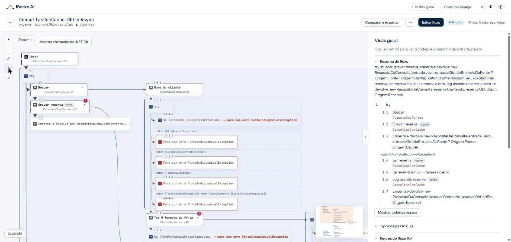

# Rastro AI

[](https://www.nuget.org/packages/rastro-ai)
[](https://github.com/felipemarcianodev/rastro-ai/actions/workflows/pr.yml)
[](LICENSE)

Segue o rastro de uma funcionalidade no seu código .NET, da entrada (controller, job, handler) até o fim (ou do clique numa tela Angular até o controller), com cada decisão, cada laço e a implementação real atrás de cada interface do DI. Mostra o fluxo como um grafo que se lê de relance e gera o prompt exato para a IA alterar aquele ponto.

O Rastro roda só na sua máquina: o código analisado nunca sai dela. Funciona sem IA; com IA, ela só propõe, e quem confirma é você.

- **Linha do tempo do método:** os passos na ordem do código, numerados (1, 2, 2.1), com o que cada método chama saindo como galho. Três desenhos (horizontal, vertical e árvore), com a mesma regra.
- **Para quem não programa também:** os comandos aparecem em português ("Se ...", "Para cada ... em ..."), com o nome legível do método e uma etiqueta do que o passo faz no mundo (banco, mensagem, cache, arquivo, fila). Um resumo em frase abre a visão geral.
- **Prova do compilador:** cada ligação mostra a origem (extraída do código, inferida pela IA ou confirmada por você). O que a IA propõe passa pelo Roslyn antes de entrar.
- **Entre sistemas:** o levantamento segue a chamada HTTP de uma API .NET para outra cadastrada no Rastro, com as bifurcações de cada sistema no mesmo desenho.
- **Da tela ao gateway:** o levantamento pode começar num componente Angular (opcional, precisa do Node), e o clique no botão chega ao controller e às APIs seguintes.
- **Visão consolidada:** o fluxo resumido em poucos passos de leitura de negócio, em Mermaid editável, com as cores que você escolher.
- **Mudança desenhada no grafo:** você edita o fluxo, o Rastro gera o prompt da mudança e, depois que o agente aplica, valida contra o código novo (build, testes e o fluxo de novo).
- **Arquitetura:** exporta o fluxo em Mermaid e SVG e a arquitetura em C4 (Structurizr), e aponta melhorias e dívida técnica (DDD, código limpo, métricas).



## Instalar e usar

Requer o SDK do .NET 10 (o Rastro carrega a sua solution com o MSBuild dele). O **Node** (20 ou mais novo) é opcional: só é preciso para levantar fluxos Angular (veja a seção própria). O pacote está no NuGet: [`rastro-ai`](https://www.nuget.org/packages/rastro-ai).

```bash
dotnet tool install -g rastro-ai
rastro                      # tela em http://127.0.0.1:7450 (só nesta máquina; --porta troca)
```

Para atualizar ou remover, pare o `rastro` antes (no Windows, o executável em uso não pode ser trocado):

```bash
dotnet tool update -g rastro-ai
dotnet tool uninstall -g rastro-ai
```

Cadastre os repositórios em Configurações (a engrenagem no alto da tela) ou pelo terminal. Os comandos de build e de testes, usados na validação de uma mudança, só se informam pelo terminal:

```bash
rastro repo add minha-api C:\codigo\minha-api --build "dotnet build MinhaApi.slnx" --testes "dotnet test MinhaApi.slnx --no-build"
```

| Comando | O que faz |
|---|---|
| `rastro` | Sobe a tela (API e front embutidos), só em `127.0.0.1` |
| `rastro repo add/remove/list` | Repositórios que o Rastro pode ler (`~/.rastro/config.json`) |
| `rastro mcp` | Servidor MCP para o seu agente de IA |

Os dados ficam em `~/.rastro` (banco SQLite `rastro.db` e `config.json`); a variável `RASTRO_HOME` troca a pasta.

## IA opcional e plugável

O Rastro **funciona sem IA**. A IA entra por dois modos, e os dois passam pela mesma porta, o validador de prova do núcleo ([ADR-001](docs/adr/adr-001-ia-opcional-e-plugavel.md)):

| Jeito de usar | Precisa de quê | Quem completa o que o compilador não resolveu |
|---|---|---|
| **Sem IA** | nada | você, à mão |
| **Modo agente** (`rastro mcp`) | um agente com MCP (ex.: Claude Code) | o agente, usando as ferramentas do Rastro |
| **Modo provedor** | chave de API de Claude, OpenAI ou Gemini, em Configurações | o próprio Rastro |

```
             Rastro.Extractor (Roslyn) ──► Rastro.Core (grafo + validador de prova)
                                                    ▲              ▲
                                         propostas  │              │  propostas
                                       Rastro.Mcp (agente)   Rastro.Ai (provedor)
```

Regra que não se quebra: `Rastro.Core` e `Rastro.Extractor` **nunca** referenciam código de IA, e um teste de arquitetura garante isso.

### Com o Claude Code (MCP)

```bash
claude mcp add rastro -- rastro mcp
```

Ferramentas: `list_repositories`, `analyze_flow`, `list_surveys`, `get_flow`, `list_unresolved`, `list_cross_edges`, `get_node_code`, `search_methods`, `propose_edge`, `describe_node`, `impact_of`, `get_change_prompt`, `check_change`, `list_findings`, `get_refactor_prompt` e `get_c4`. Peça, por exemplo: *"use o rastro para completar os buracos do levantamento X e escrever as regras das decisões"*.

- Toda proposta passa pelo validador de prova: o compilador confere o método de destino e o `arquivo:linha`. Prova errada volta recusada, com o motivo.
- Proposta aceita entra como **inferida**. **Só você confirma ou descarta**, na tela; o agente não tem ferramenta para isso.

## Fluxo entre sistemas

Quando uma API chama outra por HTTP, o fluxo não termina na chamada. Ao criar o levantamento, escolha **Seguir chamadas HTTP para** e marque os outros repositórios (eles precisam estar cadastrados no Rastro). O Rastro casa o verbo e a rota de cada chamada com as rotas desses repositórios, abre o método que atende e continua o rastro ali. As bifurcações de cada sistema aparecem no mesmo desenho, e cada passo mostra de qual sistema vem.

O que o compilador não consegue casar vira um passo "não resolvido", com o motivo:

- **rota montada em tempo de execução:** a URL é calculada, então não há rota fixa para procurar;
- **sem destino:** nenhum dos repositórios marcados atende a chamada;
- **mais de um destino:** a rota casa com mais de um método.

Quem completa é a IA (modo provedor, que recebe os repositórios marcados e as rotas deles) ou o agente (modo agente). No MCP, `list_cross_edges` lista as ligações entre sistemas e as chamadas ainda sem destino, e `propose_edge` ganha o parâmetro `system`, com o repositório de destino. A proposta passa pela mesma prova do compilador e pelo índice de rotas: o método precisa atender o verbo e a rota da chamada. Entra como inferida, e só você confirma.

Limites: a edição do fluxo e a validação de uma mudança valem só para o primeiro sistema do levantamento, e o Rastro mantém uma solution aberta por vez.

## Fluxo Angular (opcional)

O levantamento pode começar no clique de uma tela Angular. Requisitos: o **Node** no PATH (o Rastro confere ao subir; sem ele, a tela não oferece o Angular) e o **`npm install` já feito no repositório Angular**, porque o Rastro lê o código com o compilador do TypeScript do próprio projeto (o pacote não leva o compilador, e a versão é a que o projeto usa). Em monorepo, com o app numa subpasta (`frontend/`), o `npm install` vale feito na subpasta: o Rastro procura o TypeScript da pasta do `tsconfig` até a raiz do repositório. Para forçar outro compilador, suba o Rastro com `RASTRO_TYPESCRIPT` apontando para a pasta do pacote `typescript`.

Ao criar o levantamento, no lugar da solution escolha o `tsconfig` do app (a tela sugere o `tsconfig.app.json` das pastas com `angular.json`; qualquer `tsconfig.json` ou `tsconfig.*.json` dentro do repositório serve) e informe o ponto de entrada no formato `Componente.metodo`, por exemplo `DetalhePedidoComponent.cancelar`. O Rastro mostra, no começo do fluxo, as condições da tela que guardam o botão (`@if`, `*ngIf`, `[disabled]`), segue o método pelos services e pelo `HttpClient` e liga cada chamada ao controller que a atende, como no fluxo entre sistemas. Para atravessar até as APIs, marque os repositórios .NET em **Seguir chamadas HTTP para**. Sem essa lista, o levantamento mostra só o trecho Angular, com a chamada HTTP no ponto onde ela sai.

O que o Rastro não consegue ler vira um passo "não resolvido", com o motivo, como no .NET:

- **rota montada fora do código:** a URL vem de configuração ou de uma variável que o código não fixa (o endereço base da API, no começo da URL, é descartado e não atrapalha);
- **sem destino ou mais de um destino:** nenhum repositório marcado atende a chamada, ou mais de um atende;
- **classe escolhida só em tempo de execução:** mais de uma implementação possível, ou nenhuma;
- **limite de profundidade:** a cadeia passou do limite escolhido.

Limite do leitor de template: as bifurcações da tela vêm de uma leitura leve do HTML do componente (blocos `@if`, `*ngIf` e `[disabled]` ao redor do elemento com o evento do método), sem o compilador do Angular. Condições montadas de outro jeito (por exemplo, dentro de um componente filho) não aparecem. O tempo máximo da leitura é 120 s e se troca em `Rastro:Analysis:TypeScriptTimeoutSeconds`. A edição do fluxo e a validação de uma mudança, por enquanto, valem só para fluxos .NET.

## Visão consolidada

Em `surveys/:id/visao` o fluxo aparece resumido em poucos passos, em frase, como um `flowchart` Mermaid: a entrada, as bifurcações com o texto de cada ramo, as chamadas externas e os retornos antecipados. A geração é determinística, sem IA. O texto do Mermaid fica ao lado da prévia e pode ser editado; clicar num passo abre a escolha de cor (fundo, borda e texto), que vira `classDef` no próprio texto. A versão editada fica salva no levantamento, e "Gerar de novo" mantém as cores e os textos dos passos que ainda existem.

## Como funciona

- **Extrator (Roslyn e MSBuild):** carrega a solution real, com os tipos resolvidos, segue as chamadas a partir do ponto de entrada e resolve as interfaces pelo registro do DI. O que o compilador não alcança (reflection, despacho dinâmico) vira um passo "não resolvido", com o motivo.
- **Extrator Angular (Node e TypeScript):** um script (`extractor-ts`, que vai dentro do pacote) roda no Node com o compilador do TypeScript do repositório analisado e devolve o mesmo grafo. É determinístico e não usa IA ([ADR-005](docs/adr/adr-005-extrator-angular.md)).
- **Grafo como visão:** o código é a fonte da verdade. Cada levantamento guarda o hash do commit, e o grafo é refeito a cada análise.
- **Desenho próprio:** a linha do tempo é calculada pelo Rastro (sem ELK), na ordem do código, e desenhada com o Foblex Flow.
- **Segurança:** a API só escuta em `127.0.0.1`, recusa pedido de outro site e só lê pastas cadastradas. Build e testes da validação rodam sem shell, com o comando da configuração.

Visão e decisões em [`docs/arquitetura/visao.md`](docs/arquitetura/visao.md) e nas [ADRs](docs/adr/).

## Estrutura

| Pasta | O quê |
|---|---|
| [`backend/`](backend/) | .NET 10: extrator (Roslyn), núcleo, API, MCP, IA (provedores) e testes (xUnit) |
| [`frontend/`](frontend/) | a tela em Angular 20 e Foblex Flow, com testes no Karma |
| [`extractor-ts/`](extractor-ts/) | o extrator Angular (script Node com o compilador do TypeScript), com testes em `node --test` |
| [`docker/`](docker/) | imagem opcional, para rodar o Rastro num container |
| [`docs/`](docs/) | visão, ADRs, plano faseado e prints das telas |
| [`scripts/`](scripts/) | geração do pacote e conferência do que vai a público |

## Desenvolver

| Como | Comando | Endereço |
|---|---|---|
| API local | `dotnet run --project backend/src/Rastro.Api` | http://localhost:5310 |
| Front local | `cd frontend && npm install && npm start` (proxy de `/api` para a API local) | http://localhost:4300 |
| MCP local | `dotnet run --project backend/src/Rastro.Api -- mcp` | stdio |
| CLI de análise | `dotnet run --project backend/src/Rastro.Cli -- analyze <solution> <Tipo.Metodo> --out fluxo.json` | |

Antes de abrir um pull request:

```bash
dotnet build backend/Rastro.slnx && dotnet test backend/Rastro.slnx
cd frontend && npm run build && npm run test:ci
cd extractor-ts && npm ci && npm test
```

O teste de integração do backend roda o extrator Angular de verdade: precisa do Node e do `npm ci` feito em `extractor-ts`.

Pacote local: `powershell -File scripts/empacotar.ps1` gera `artifacts/rastro-ai.<versão>.nupkg` (front embutido no `wwwroot` da API), e `dotnet tool install -g rastro-ai --add-source artifacts` instala para testar.

**Docker (opcional):** `docker compose -f docker/docker-compose.yml up -d --build` sobe em http://localhost:7400, com o banco no volume `rastro-data` e os repositórios montados só para leitura (`REPOS_DIR`, `REPO_0_NAME` e `REPO_0_FOLDER`).

### Publicar uma versão

A publicação no NuGet é feita pelo workflow [`release.yml`](.github/workflows/release.yml), com a Publicação Confiável do nuget.org (sem chave de API guardada):

1. Suba o [`VERSION`](VERSION) (e a versão do `frontend/package.json`) num pull request. O nuget.org não aceita a mesma versão duas vezes, e uma versão publicada não se apaga, só se oculta.
2. Depois do merge, crie a tag na `main`: `git tag -a v0.1.2 -m "Rastro AI 0.1.2"` e `git push origin v0.1.2`. Tag diferente do `VERSION` é recusada.
3. O workflow roda os testes do backend e do front, gera o pacote e para no environment `release`, esperando a aprovação do mantenedor ("Review deployments" na execução). Com a aprovação, ele publica.

## Como foi construído

Construído em par com o Claude (Claude Code), fase a fase, com plano, testes e prints de cada tela a cada fase: [`docs/arquitetura/plano-mvp.md`](docs/arquitetura/plano-mvp.md).

## Licença

[MIT](LICENSE). Falhas de segurança: veja [SECURITY.md](SECURITY.md).
