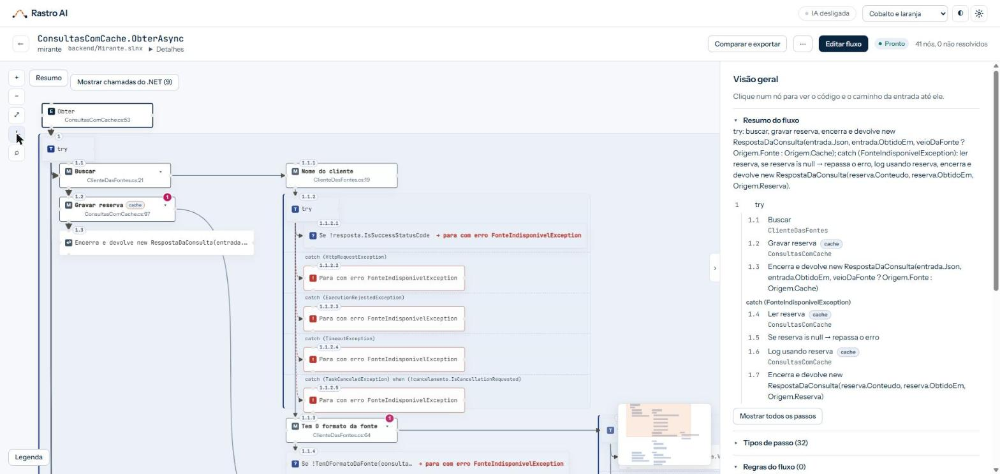

# Rastro AI

[](https://www.nuget.org/packages/rastro-ai)
[](https://github.com/felipemarcianodev/rastro-ai/actions/workflows/pr.yml)
[](LICENSE)

Segue o rastro de uma funcionalidade no seu código .NET, da entrada (controller, job, handler) até o fim (ou do clique numa tela Angular até o controller), com cada decisão, cada laço e a implementação real atrás de cada interface do DI. Mostra o fluxo como um grafo que se lê de relance e gera o prompt exato para a IA alterar aquele ponto.

O Rastro roda só na sua máquina: o código analisado nunca sai dela. Funciona sem IA; com IA, ela só propõe, e quem confirma é você.

- **Linha do tempo do método:** os passos na ordem do código, numerados (1, 2, 2.1), com o que cada método chama saindo como galho. Três desenhos (horizontal, vertical e árvore), com a mesma regra.
- **Para quem não programa também:** os comandos aparecem em português ("Se ...", "Para cada ... em ..."), com o nome legível do método e uma etiqueta do que o passo faz no mundo (banco, mensagem, cache, arquivo, fila). Um resumo em frase abre a visão geral.
- **Prova do compilador:** cada ligação mostra a origem (extraída do código, inferida pela IA ou confirmada por você). O que a IA propõe passa pelo Roslyn antes de entrar.
- **Entre sistemas:** o levantamento segue a chamada HTTP de uma API .NET para outra cadastrada no Rastro, com as bifurcações de cada sistema no mesmo desenho.
- **Da tela ao gateway:** o levantamento pode começar num componente Angular (opcional, precisa do Node), e o clique no botão chega ao controller e às APIs seguintes.
- **Visão consolidada:** o fluxo resumido em poucos passos de leitura de negócio, em Mermaid editável, com as cores que você escolher.
- **Mapa do fluxo:** o nível de um diagrama C2, com uma faixa por sistema, poucos blocos em cada uma, as decisões que mudam o desfecho, as chamadas entre sistemas (verbo, rota e campos enviados) e, na API e no MCP, os caminhos de ponta a ponta. Os sistemas além do segundo salto vêm recolhidos e abrem ao clicar, e clicar no desfecho de uma decisão acende o caminho dele.
- **Regras e perguntas:** as decisões viram regras em frase (bloqueia, permite, efeito colateral), com a fonte no código, e o Rastro responde perguntas prontas de quem revisa (TL, Staff, gerente). Com IA ligada, pergunta livre, sempre com as fontes conferidas.
- **Esquema do banco pelo código:** tabelas, colunas, chaves, índices, views e procedures lidos do modelo do EF Core, das migrations e dos `.sql` (SQL Server e PostgreSQL, o dialeto sai do repositório), com a fonte de cada item e a divergência entre fontes marcada. Sem conectar em banco nenhum e sem ler dados. Na tela "Mapa do banco" de cada repositório, na API e no MCP.
- **Análise de consulta sem IA:** cole uma consulta SQL (ou abra a de um passo do fluxo) e o Rastro aponta os gargalos por gravidade, com o trecho marcado e o motivo, cruzando com o esquema: `SELECT *`, função na coluna do filtro, `LIKE '%...'` (e `ILIKE` no PostgreSQL), conversão com `::`, coluna sem índice, junção sem condição e outros. A consulta não é executada.
- **Mudança desenhada no grafo:** você edita o fluxo, o Rastro gera o prompt da mudança e, depois que o agente aplica, valida contra o código novo (build, testes e o fluxo de novo).
- **Arquitetura:** exporta o fluxo em Mermaid e SVG e a arquitetura em C4 (Structurizr), e aponta melhorias e dívida técnica (DDD, código limpo, métricas).



## Instalar e usar

Requer o SDK do .NET 10 (o Rastro carrega a sua solution com o MSBuild dele). O **Node** (20 ou mais novo) é opcional: só é preciso para levantar fluxos Angular (veja a seção própria). O pacote está no NuGet: [`rastro-ai`](https://www.nuget.org/packages/rastro-ai).

```bash
dotnet tool install -g rastro-ai
rastro                      # tela em http://127.0.0.1:7450 (só nesta máquina; --porta troca)
```

Se o Rastro já estiver aberto nessa porta, o comando só mostra o endereço e termina. Se outro programa estiver nela, ele pede que você escolha outra com `--porta`.

Para atualizar ou remover, pare o `rastro` antes (no Windows, o executável em uso não pode ser trocado):

```bash
dotnet tool update -g rastro-ai
dotnet tool uninstall -g rastro-ai
```

Cadastre os repositórios em Configurações (a engrenagem no alto da tela) ou pelo terminal. Os comandos de build e de testes, usados na validação de uma mudança, só se informam pelo terminal:

```bash
rastro repo add minha-api C:\codigo\minha-api --build "dotnet build MinhaApi.slnx" --testes "dotnet test MinhaApi.slnx --no-build"
```

| Comando | O que faz |
|---|---|
| `rastro` | Sobe a tela (API e front embutidos), só em `127.0.0.1` |
| `rastro repo add/remove/list` | Repositórios que o Rastro pode ler (`~/.rastro/config.json`) |
| `rastro mcp` | Servidor MCP para o seu agente de IA |

Os dados ficam em `~/.rastro` (banco SQLite `rastro.db` e `config.json`); a variável `RASTRO_HOME` troca a pasta.

## IA opcional e plugável

O Rastro **funciona sem IA**. A IA entra por dois modos, e os dois passam pela mesma porta, o validador de prova do núcleo ([ADR-001](docs/adr/adr-001-ia-opcional-e-plugavel.md)):

| Jeito de usar | Precisa de quê | Quem completa o que o compilador não resolveu |
|---|---|---|
| **Sem IA** | nada | você, à mão |
| **Modo agente** (`rastro mcp`) | um agente com MCP (ex.: Claude Code) | o agente, usando as ferramentas do Rastro |
| **Modo provedor** | chave de API de Claude, OpenAI ou Gemini, em Configurações | o próprio Rastro |

```
             Rastro.Extractor (Roslyn) ──► Rastro.Core (grafo + validador de prova)
                                                    ▲              ▲
                                         propostas  │              │  propostas
                                       Rastro.Mcp (agente)   Rastro.Ai (provedor)
```

Regra que não se quebra: `Rastro.Core` e `Rastro.Extractor` **nunca** referenciam código de IA, e um teste de arquitetura garante isso.

### Com o Claude Code (MCP)

```bash
claude mcp add rastro -- rastro mcp
```

Ferramentas: `list_repositories`, `analyze_flow`, `list_surveys`, `get_flow`, `get_flow_map`, `get_flow_rules`, `list_unresolved`, `list_cross_edges`, `get_node_code`, `search_methods`, `propose_edge`, `describe_node`, `impact_of`, `get_change_prompt`, `check_change`, `list_findings`, `get_refactor_prompt`, `get_c4`, `get_db_schema`, `analyze_query` e `propose_query_rewrite`. Peça, por exemplo: *"use o rastro para completar os buracos do levantamento X e escrever as regras das decisões"*.

- Toda proposta passa pelo validador de prova: o compilador confere o método de destino e o `arquivo:linha`. Prova errada volta recusada, com o motivo.
- Proposta aceita entra como **inferida**. **Só você confirma ou descarta**, na tela; o agente não tem ferramenta para isso.
- Para uma consulta SQL, `analyze_query` dá os achados e o esquema só das tabelas que ela usa, e `propose_query_rewrite` recebe a consulta reescrita e os índices sugeridos, com o motivo de cada mudança. O Rastro confere e recusa com o motivo o que não passar; nada é aplicado nem executado, e quem copia é você.
- Para perguntas sobre o fluxo ("quando o pedido é recusado?", "o que acontece se a API de pagamentos cair?"), `get_flow_map` e `get_flow_rules` dão ao agente o mapa e as regras, e ele responde citando os passos.

### Perguntas no modo provedor

A pergunta livre da tela usa o uso **Sugestões** da configuração da IA. Numa pergunta, vão ao provedor: o texto da pergunta, o mapa do fluxo (blocos, ligações e caminhos, com os nomes dos métodos e `arquivo:linha`), as regras e o código em volta dos pontos de entrada e das decisões (até 8 trechos de cerca de 30 linhas). A resposta volta com um selo (inferida, fora do código ou sem resposta) e com as fontes; fonte que não existe no fluxo é descartada, e resposta sem nenhuma fonte válida aparece como "sem resposta no código levantado".

## Fluxo entre sistemas

Quando uma API chama outra por HTTP, o fluxo não termina na chamada. Ao criar o levantamento, escolha **Seguir chamadas HTTP para** e marque os outros repositórios (eles precisam estar cadastrados no Rastro). O Rastro reconhece a chamada pelo `HttpClient` (e pelas extensões de `System.Net.Http.Json`) e também por uma interface do Refit (métodos com `[Get]`, `[Post]`, `[Put]`, `[Patch]`, `[Delete]`, `[Head]` ou `[Options]`, com o verbo e o template tirados do atributo; o `{id}` do template casa com o parâmetro de rota do controller, e o endereço base do `AddRefitClient` é descartado). Ele casa o verbo e a rota de cada chamada com as rotas desses repositórios, abre o método que atende e continua o rastro ali. As bifurcações de cada sistema aparecem no mesmo desenho, e cada passo mostra de qual sistema vem.

O que o compilador não consegue casar vira um passo "não resolvido", com o motivo:

- **rota montada em tempo de execução:** a URL é calculada, então não há rota fixa para procurar;
- **sem destino:** nenhum dos repositórios marcados atende a chamada;
- **mais de um destino:** a rota casa com mais de um método.

Quem completa é a IA (modo provedor, que recebe os repositórios marcados e as rotas deles) ou o agente (modo agente). No MCP, `list_cross_edges` lista as ligações entre sistemas e as chamadas ainda sem destino, e `propose_edge` ganha o parâmetro `system`, com o repositório de destino. A proposta passa pela mesma prova do compilador e pelo índice de rotas: o método precisa atender o verbo e a rota da chamada. Entra como inferida, e só você confirma.

Limites: a edição do fluxo e a validação de uma mudança valem só para o primeiro sistema do levantamento, e o Rastro mantém uma solution aberta por vez.

## Fluxo Angular (opcional)

O levantamento pode começar no clique de uma tela Angular. Requisitos: o **Node** no PATH (o Rastro confere ao subir; sem ele, a tela não oferece o Angular) e o **`npm install` já feito no repositório Angular**, porque o Rastro lê o código com o compilador do TypeScript do próprio projeto (o pacote não leva o compilador, e a versão é a que o projeto usa). Em monorepo, com o app numa subpasta (`frontend/`), o `npm install` vale feito na subpasta: o Rastro procura o TypeScript da pasta do `tsconfig` até a raiz do repositório. Para forçar outro compilador, suba o Rastro com `RASTRO_TYPESCRIPT` apontando para a pasta do pacote `typescript`.

Ao criar o levantamento, no lugar da solution escolha o `tsconfig` do app (a tela sugere o `tsconfig.app.json` das pastas com `angular.json`; qualquer `tsconfig.json` ou `tsconfig.*.json` dentro do repositório serve) e informe o ponto de entrada no formato `Componente.metodo`, por exemplo `DetalhePedidoComponent.cancelar`. O Rastro mostra, no começo do fluxo, as condições da tela que guardam o botão (`@if`, `*ngIf`, `[disabled]`), segue o método pelos services e pelo `HttpClient` e liga cada chamada ao controller que a atende, como no fluxo entre sistemas. Para atravessar até as APIs, marque os repositórios .NET em **Seguir chamadas HTTP para**. Sem essa lista, o levantamento mostra só o trecho Angular, com a chamada HTTP no ponto onde ela sai.

O que o Rastro não consegue ler vira um passo "não resolvido", com o motivo, como no .NET:

- **rota montada fora do código:** a URL vem de configuração ou de uma variável que o código não fixa (o endereço base da API, no começo da URL, é descartado e não atrapalha);
- **sem destino ou mais de um destino:** nenhum repositório marcado atende a chamada, ou mais de um atende;
- **classe escolhida só em tempo de execução:** mais de uma implementação possível, ou nenhuma;
- **limite de profundidade:** a cadeia passou do limite escolhido.

Modais: quando o método abre um modal com `MatDialog.open(Componente)` ou com o `Dialog` do CDK, o fluxo ganha um galho "abre o modal Componente" com os métodos que o template do modal liga a eventos (`(click)`, `(ngSubmit)` e semelhantes, com `template` inline ou `templateUrl`), e o rastro segue dali até o `HttpClient`. Esse vínculo é a ação do usuário lida no HTML do modal, não prova do compilador: as arestas saem como **inferidas** e com o rótulo "ação do usuário no modal". O `afterClosed()` (ou `closed`) continua depois do galho. Um serviço próprio que repassa para o `MatDialog` não é reconhecido: o `open` precisa ser chamado direto no `MatDialog` ou no `Dialog` do CDK, com a classe do componente como primeiro argumento.

Limite do leitor de template: as bifurcações da tela vêm de uma leitura leve do HTML do componente (blocos `@if`, `*ngIf` e `[disabled]` ao redor do elemento com o evento do método), sem o compilador do Angular. Condições montadas de outro jeito (por exemplo, dentro de um componente filho) não aparecem. O tempo máximo da leitura é 120 s e se troca em `Rastro:Analysis:TypeScriptTimeoutSeconds`. A edição do fluxo e a validação de uma mudança, por enquanto, valem só para fluxos .NET.

## Visão consolidada

Em `surveys/:id/visao` o fluxo aparece resumido em poucos passos, em frase, como um `flowchart` Mermaid: a entrada, as bifurcações com o texto de cada ramo, as chamadas externas e os retornos antecipados. A geração é determinística, sem IA. O texto do Mermaid fica ao lado da prévia e pode ser editado; clicar num passo abre a escolha de cor (fundo, borda e texto), que vira `classDef` no próprio texto. A versão editada fica salva no levantamento, e "Gerar de novo" mantém as cores e os textos dos passos que ainda existem.

A visão também é o quarto desenho do fluxo: o botão que troca o desenho passa pelo horizontal, a linha do tempo, a árvore e o consolidado (ou o botão "Visão consolidada" da barra). Nele, clicar num passo abre o painel do passo, com o código, as ligações e o caminho desde a entrada. Arrastar o fundo move o desenho e a roda do mouse aproxima em volta do cursor. "Editar texto e cores" leva à tela de edição, onde "Ver no fluxo" volta ao passo escolhido.

## Esquema do banco

A tela **Mapa do banco** (`/repositorios/{nome}/banco`, pelo link "Ver o mapa do banco" ao escolher o repositório no levantamento novo, ou pelo "Banco" na barra de um levantamento) desenha as tabelas com PK e FK marcadas e as setas pela chave estrangeira, com a cardinalidade. Tem busca por tabela ou campo, recorte numa tabela e nas vizinhas até 3 saltos, zoom e exportação em PNG, SVG e Mermaid `erDiagram`. O painel da tabela mostra campos, índices, relações, a divergência entre fontes e os achados sem IA. Colunas com nome de dado pessoal (CPF, e-mail, telefone, nascimento, endereço) ganham a marca "pessoal", só pelo nome: o conteúdo nunca é lido.

`GET api/repositories/{nome}/schema` (e a ferramenta `get_db_schema` no MCP) devolve o esquema do banco de um repositório cadastrado, lido só dos arquivos ([ADR-006](docs/adr/adr-006-visao-do-banco.md)):

- **Modelo do EF Core**, pelo Roslyn, sem compilar nem rodar o seu código: `DbContext` e `DbSet`, atributos (`[Table]`, `[Key]`, `[Column]`, `[MaxLength]`, `[Index]`, `[ForeignKey]`), `OnModelCreating`, `IEntityTypeConfiguration`, as convenções do EF (chave `Id`, chave estrangeira `<Navegação>Id`, tabela pelo nome do `DbSet`) e o `UseSnakeCaseNamingConvention`.
- **Migrations do EF Core**, aplicadas na ordem do id: `CreateTable`, `AddColumn`, `AlterColumn`, `CreateIndex`, `AddForeignKey` e o SQL de `migrationBuilder.Sql`. O snapshot e o `.Designer.cs` não são fonte.
- **Arquivos `.sql` e projeto de banco** do SQL Server, pelo leitor oficial de T-SQL da Microsoft (`Microsoft.SqlServer.TransactSql.ScriptDom`, MIT, dentro do pacote): `CREATE TABLE`, `ALTER TABLE ... ADD CONSTRAINT`, `CREATE INDEX`, `CREATE VIEW` e `CREATE PROCEDURE` (parâmetros e as tabelas que ela lê e grava).
- **Arquivos `.sql` do PostgreSQL**, pelo SqlParserCS (MIT, código gerenciado, sem biblioteca nativa, dentro do pacote): `CREATE TABLE` (com `serial`, identidade, `jsonb` e as chaves na coluna ou na tabela), `ALTER TABLE ... ADD`, `CREATE INDEX`, `CREATE VIEW` (e a materializada), `CREATE FUNCTION` e `CREATE PROCEDURE` (parâmetros e as tabelas que o corpo lê e grava). O resto do que o `pg_dump` escreve (`SET`, `CREATE EXTENSION`, a carga do `COPY`) é ignorado, e cada instrução é lida sozinha: a que o leitor não entende vira nota sem derrubar as outras.

**O dialeto sai do repositório**, sem pergunta: o `UseNpgsql` ou o `UseSqlServer` no código, as anotações das migrations (`Npgsql:` ou `SqlServer:`) e, sem EF, as marcas dos `.sql` (`serial`, `jsonb`, `::` e `$$` de um lado; `nvarchar`, colchete e `GO` do outro). Sem marca nenhuma, SQL Server. Com o Npgsql, o tipo por convenção é o que ele gera (`text`, `character varying(n)`, `timestamp with time zone`, `uuid`, `jsonb`, `numeric`, vetores como `text[]`), a identidade vem do `UseIdentityByDefaultColumn`, do `UseIdentityAlwaysColumn`, do `serial` e da anotação da migration, e os sinônimos do PostgreSQL (`int` e `integer`, `varchar` e `character varying`, `timestamptz`) não contam como divergência. Com o `UseSnakeCaseNamingConvention`, a chave, a FK e o índice ganham o nome em minúsculas que o EF dá (`pk_pedidos`).

Cada item traz o arquivo e a linha de onde veio. Quando as fontes discordam no tipo, no nulo, na chave primária ou na existência de uma coluna, a divergência mostra cada versão com a fonte, e a coluna divergente fica sem tipo (ou sem nulo): o Rastro não escolhe em silêncio. O que não dá para ler (arquivo `.sql` com erro, tipo próprio do EF com `OwnsOne`, entidade fora do repositório) vira uma nota. Ficam de fora as pastas `bin`, `obj` e `node_modules` e os `.sql` acima de 2 MB.

O índice que o EF cria por convenção em cada chave estrangeira é deduzido do modelo e marcado como convenção, e só aparece quando a tabela não tem migration nem `.sql` (eles dizem o que o banco de fato tem). Achado sem IA: a migration ou o `.sql` que cria uma chave estrangeira sem um índice que comece pelas colunas dela (`findings` na resposta).

**Banco nos fluxos.** No levantamento, o passo que usa o EF Core diz qual tabela lê ou grava e por qual operação (consulta, inclusão, alteração, exclusão), pelo `DbSet` (ou `Set<T>`), pelo método do EF e pelo `Add`, `Update` e `Remove` do `DbContext`; a procedure chamada por `FromSql`, `ExecuteSql` ou `SqlQuery` com `EXEC` aparece como execução. O nome da tabela sai do esquema do repositório. No painel da tabela, "Fluxos que usam esta tabela" lista os passos (do levantamento mais novo de cada método) com o link para o passo, e `GET api/repositories/{nome}/schema/usage` devolve os mesmos usos e os achados. Achados sem IA, na categoria "Banco de dados" das melhorias: consulta dentro de laço (N+1, direta ou por um método que consulta), `ToList` antes do filtro, leitura sem `AsNoTracking` num método que não grava, procedure chamada por SQL cru, `ToList` só para apagar com `RemoveRange` (o certo é `ExecuteDeleteAsync`) e `LIKE` montado no código com curinga no começo (`$"%{termo}%"`), que o índice B-tree não atende. Repositório genérico (`IRepository<T>`, `EfRepository<T>`): o `T` é fechado pela chamada, então o passo mostra a tabela da entidade (e não `DbSet`), a chamada por interface que reimplementa um membro com `new` vai ao membro certo, e o N+1, o `AsNoTracking` que falta e o `ToList` do repositório seguido de `Where` no chamador aparecem no passo certo. Levantamento feito antes desta versão não tem essa informação: levante o fluxo de novo. Dapper e ADO.NET continuam só com a etiqueta "banco", sem a tabela.

**Analisar consulta.** A segunda aba da tela do banco (`/repositorios/{nome}/banco?aba=consulta`) recebe uma consulta colada (no dialeto do repositório: SQL Server ou PostgreSQL) ou a de um passo do fluxo: o passo com SQL cru literal (`FromSql`, `FromSqlRaw`, `ExecuteSqlRaw`, `SqlQuery`) ganha o link "Analisar a consulta", com os marcadores `{0}` e os buracos da interpolação trocados por `@p0`, `@p1`. O leitor de SQL do dialeto (o oficial de T-SQL, ou o SqlParserCS no PostgreSQL) lê a consulta, sem executá-la e sem IA, e cada achado vem com a gravidade (alta, média, baixa; na API, de 0 a 2, e o número maior é o mais grave, como nos achados do fluxo), o trecho marcado no texto (dentro do filtro ou do `ON`, e não na lista do `SELECT`) e o motivo; clicar no achado destaca o trecho. As regras: `SELECT *` (cita as colunas de dado pessoal que vêm junto), função, conversão ou conta na coluna do filtro, `LIKE` com curinga no começo, `OR` entre colunas diferentes, filtro ou junção em coluna sem índice que comece por ela (pelo esquema lido do código; um índice composto atende quando as colunas iniciais dele estão todas no filtro com igualdade), leitura sem `LIMIT` ou `TOP` numa tabela filtrada só por igualdade em coluna que não identifica a linha (gravidade baixa; a lista filha de um pai, filtrada pela chave estrangeira, fica de fora, menos quando a chave aponta para uma tabela que três ou mais outras apontam, como a do tenant), junção sem condição (`CROSS JOIN`, vírgula no `FROM` sem ligação no `WHERE`, `ON` sem coluna das duas tabelas), `DISTINCT` numa consulta com junção, subconsulta correlacionada, `ORDER BY` sem `TOP` nem `OFFSET`, `NOT IN` de subconsulta cuja coluna aceita nulo e `UPDATE` ou `DELETE` sem `WHERE`. No PostgreSQL, as mesmas regras, com `LIMIT` ou `FETCH` no lugar do `TOP`, o operador jsonb (`->>`, `->`) e `unnest` ou `ANY` sobre coluna de lista com texto próprio (não usam índice B-tree), o índice de trigrama (`USING gin (coluna gin_trgm_ops)`, lido do `.sql` e do `migrationBuilder.Sql`) atendendo o `LIKE` e o `ILIKE` com curinga no começo, a propriedade de classe guardada em `jsonb` lida como coluna do modelo, o `UPDATE ... FROM` e o `DELETE ... USING` contando como junção, mais o `ILIKE` com curinga no começo e a conversão com `::` na coluna do filtro; `$1` e `@nome` são parâmetros. Tabela que não está no esquema aparece marcada, sem os achados de índice e de nulo. Na API, `POST api/repositories/{nome}/schema/analyze` com `{ "sql": "..." }` (até 100 mil caracteres); no MCP, `analyze_query`. O texto da consulta não vai para o log.

**Banco vivo (opcional, só de leitura).** Pelo botão "Conectar banco vivo" da tela do banco, você cadastra a string de conexão de um SQL Server ou de um PostgreSQL para o repositório. O dialeto sai da própria string (`Host`, `Port` e `Username` são do PostgreSQL; `Data Source`, `Initial Catalog` e `TrustServerCertificate` são do SQL Server) e, quando ela serve aos dois (`Server=...;Database=...;User Id=...`), vale o dialeto do código do repositório. No PostgreSQL, use o formato chave=valor (`Host=...;Database=...;Username=...;Password=...`), não a URL. Ela fica cifrada no banco local (`~/.rastro/rastro.db`, com o DataProtection, como a chave da IA) e nunca volta para a tela, para o log nem para a IA; a tela mostra só o servidor e o banco. Com a conexão:

- o **catálogo** (tabelas, colunas, chaves, índices, views e procedures) entra como mais uma fonte do esquema, marcada "banco vivo", e a divergência com o código aparece como as outras. Se o banco não responder, o esquema sai só do código, com uma nota;
- na aba "Analisar consulta", "Pedir o plano estimado" pede ao banco o plano, **sem executar a consulta**: no SQL Server, por `SET SHOWPLAN_XML ON` (as operações mais caras, as varreduras e o índice que o próprio banco diz faltar), com o leitor de T-SQL conferindo antes que a consulta é uma instrução só (`SELECT`, `INSERT`, `UPDATE`, `DELETE` ou `MERGE`), sem `SET`, `EXEC`, DDL, `GO`, `SELECT INTO` nem acesso a outro servidor, e as variáveis (`@p0`) declaradas como texto;
- no PostgreSQL, por `EXPLAIN (FORMAT JSON)` **sem `ANALYZE`**, dentro de uma transação só de leitura que sempre volta atrás, numa conexão aberta com `default_transaction_read_only` ligado. Antes, o leitor de SQL do PostgreSQL confere que é uma instrução só, sem `SELECT INTO`, sem escrita dentro de outra instrução e sem função de efeito colateral conhecida (`pg_sleep`, `set_config`, `nextval`, `dblink`, leitura de arquivo, trava). Com parâmetro (`$1` ou `@nome`), a consulta vira um `PREPARE` e o plano é o genérico, que não depende do valor (PostgreSQL 12 em diante). O comando vai num lote de um só, e o próprio PostgreSQL recusa duas instruções nele. O PostgreSQL não aponta índice faltando: os achados sem IA cobrem a coluna sem índice.

O Rastro **nunca lê os dados das tabelas**. Os comandos ao catálogo são fixos no código (`sys.*` no SQL Server, `pg_catalog` no PostgreSQL), a conexão tem tempo limite e não entra em pool, e o driver é o oficial de cada banco (`Microsoft.Data.SqlClient` e `Npgsql`, licença PostgreSQL, os dois dentro do pacote). Use um usuário só de leitura: no SQL Server, `GRANT VIEW DEFINITION TO usuario` basta para o catálogo; o plano estimado pede também `GRANT SHOWPLAN TO usuario` e o `SELECT` nas tabelas da consulta, porque o SQL Server só mostra o plano a quem pode rodar a instrução. No PostgreSQL, `GRANT CONNECT ON DATABASE banco TO usuario` basta para o catálogo; o plano pede o `USAGE` no schema e o `SELECT` nas tabelas da consulta (o PostgreSQL confere a permissão da instrução também no `EXPLAIN`), e vale deixar o usuário só de leitura também no banco (`ALTER ROLE usuario SET default_transaction_read_only = on`). Na API: `GET`, `PUT` e `DELETE api/repositories/{nome}/connection`, `POST api/repositories/{nome}/connection/test` e `POST api/repositories/{nome}/schema/plan`. O banco vivo é só pela tela e pela API; o MCP continua lendo o esquema do código.

**A IA sugere a melhora (opcional).** Com o modo provedor ligado e o uso **Sugestões** marcado, a aba "Analisar consulta" ganha o botão "Sugerir melhora com a IA"; sem IA ligada, o botão não aparece. A IA devolve a consulta reescrita e os índices sugeridos, com o motivo de cada mudança, e o Rastro confere tudo antes de mostrar, sem IA: a reescrita precisa ser lida pelo leitor de SQL do dialeto do repositório, ser uma instrução só da mesma operação na mesma tabela, citar só tabelas e colunas que existem no esquema e devolver as mesmas colunas, com os mesmos nomes e na mesma ordem, sem limitar as linhas (`TOP`, `LIMIT`, `OFFSET` ou `FETCH`) que a original não limita; o índice só usa colunas que existem e não repete um índice nem a chave primária que já começa pelas mesmas colunas. O que não passa aparece recusado, com o motivo. A tela mostra a consulta antes e depois lado a lado, os achados antes e depois e, com banco vivo, o custo estimado do plano das duas, sem executar nenhuma. O comando `CREATE INDEX` é escrito pelo Rastro, no dialeto (colchete no SQL Server, aspas duplas no PostgreSQL). **Nada é aplicado**: quem copia a consulta e cria o índice é você. Vão ao provedor numa análise: a consulta como você colou (inclusive os literais), os achados e só as tabelas que ela usa (nomes, colunas, tipos, nulo, chaves e índices, do código e, com banco vivo, do catálogo), marcados como dado. **Nunca vão** a string de conexão, os dados das tabelas nem as outras tabelas do esquema. Na API: `POST api/repositories/{nome}/schema/ai/suggestion` com `{ "sql": "..." }`; no MCP, `analyze_query` seguido de `propose_query_rewrite`, com a mesma conferência.

Limites: configuração montada em tempo de execução não é lida. No PostgreSQL, o corpo em PL/pgSQL da função é lido pelos tokens (as tabelas depois de `FROM`, `JOIN`, `INSERT INTO`, `UPDATE` e `DELETE FROM`), e o plano de consulta com parâmetro pede o PostgreSQL 12 ou mais novo.

## Como funciona

- **Extrator (Roslyn e MSBuild):** carrega a solution real, com os tipos resolvidos, segue as chamadas a partir do ponto de entrada e resolve as interfaces pelo registro do DI. O que o compilador não alcança (reflection, despacho dinâmico) vira um passo "não resolvido", com o motivo.
- **Extrator Angular (Node e TypeScript):** um script (`extractor-ts`, que vai dentro do pacote) roda no Node com o compilador do TypeScript do repositório analisado e devolve o mesmo grafo. É determinístico e não usa IA ([ADR-005](docs/adr/adr-005-extrator-angular.md)).
- **Grafo como visão:** o código é a fonte da verdade. Cada levantamento guarda o hash do commit, e o grafo é refeito a cada análise.
- **Desenho próprio:** a linha do tempo é calculada pelo Rastro (sem ELK), na ordem do código, e desenhada com o Foblex Flow.
- **Segurança:** a API só escuta em `127.0.0.1`, recusa pedido de outro site e só lê pastas cadastradas. Build e testes da validação rodam sem shell, com o comando da configuração.

Visão e decisões em [`docs/arquitetura/visao.md`](docs/arquitetura/visao.md) e nas [ADRs](docs/adr/).

## Estrutura

| Pasta | O quê |
|---|---|
| [`backend/`](backend/) | .NET 10: extrator (Roslyn), núcleo, API, MCP, IA (provedores) e testes (xUnit) |
| [`frontend/`](frontend/) | a tela em Angular 20 e Foblex Flow, com testes no Karma |
| [`extractor-ts/`](extractor-ts/) | o extrator Angular (script Node com o compilador do TypeScript), com testes em `node --test` |
| [`docker/`](docker/) | imagem opcional, para rodar o Rastro num container |
| [`docs/`](docs/) | visão, ADRs, plano faseado e prints das telas |
| [`scripts/`](scripts/) | geração do pacote e conferência do que vai a público |

## Desenvolver

| Como | Comando | Endereço |
|---|---|---|
| API local | `dotnet run --project backend/src/Rastro.Api` | http://localhost:5310 |
| Front local | `cd frontend && npm install && npm start` (proxy de `/api` para a API local) | http://localhost:4300 |
| MCP local | `dotnet run --project backend/src/Rastro.Api -- mcp` | stdio |
| CLI de análise | `dotnet run --project backend/src/Rastro.Cli -- analyze <solution> <Tipo.Metodo> --out fluxo.json` | |

Antes de abrir um pull request:

```bash
dotnet build backend/Rastro.slnx && dotnet test backend/Rastro.slnx
cd frontend && npm run build && npm run test:ci
cd extractor-ts && npm ci && npm test
```

O teste de integração do backend roda o extrator Angular de verdade: precisa do Node e do `npm ci` feito em `extractor-ts`.

Pacote local: `powershell -File scripts/empacotar.ps1` gera `artifacts/rastro-ai.<versão>.nupkg` (front embutido no `wwwroot` da API), e `dotnet tool install -g rastro-ai --add-source artifacts` instala para testar.

**Docker (opcional):** `docker compose -f docker/docker-compose.yml up -d --build` sobe em http://localhost:7400, com o banco no volume `rastro-data` e os repositórios montados só para leitura (`REPOS_DIR`, `REPO_0_NAME` e `REPO_0_FOLDER`).

### Publicar uma versão

A publicação no NuGet é feita pelo workflow [`release.yml`](.github/workflows/release.yml), com a Publicação Confiável do nuget.org (sem chave de API guardada):

1. Suba o [`VERSION`](VERSION) (e a versão do `frontend/package.json`) num pull request. O nuget.org não aceita a mesma versão duas vezes, e uma versão publicada não se apaga, só se oculta.
2. Depois do merge, crie a tag na `main`: `git tag -a v0.1.2 -m "Rastro AI 0.1.2"` e `git push origin v0.1.2`. Tag diferente do `VERSION` é recusada.
3. O workflow roda os testes do backend e do front, gera o pacote e para no environment `release`, esperando a aprovação do mantenedor ("Review deployments" na execução). Com a aprovação, ele publica.

## Como foi construído

Construído em par com o Claude (Claude Code), fase a fase, com plano, testes e prints de cada tela a cada fase: [`docs/arquitetura/plano-mvp.md`](docs/arquitetura/plano-mvp.md).

## Licença

[MIT](LICENSE). Falhas de segurança: veja [SECURITY.md](SECURITY.md).
