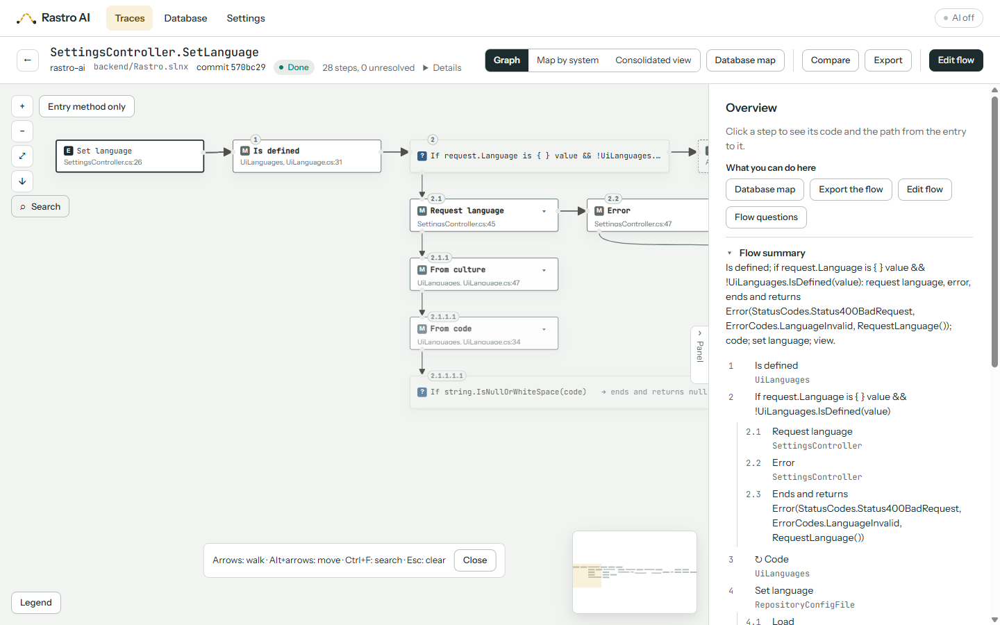

# Rastro AI

**English** · [Português](README.pt-BR.md) · [Español](README.es.md)

[](https://www.nuget.org/packages/rastro-ai)
[](https://github.com/felipemarcianodev/rastro-ai/actions/workflows/pr.yml)
[](LICENSE)

Rastro follows the trail of a feature through your .NET code, from the entry point (controller, job, handler) to the end (or from a click on an Angular screen all the way to the controller), with every decision, every loop, and the real implementation behind each DI interface. It shows the flow as a graph you can read at a glance and generates the exact prompt for an AI to change that spot.

Rastro runs only on your machine: the code it analyzes never leaves it. It works without AI; with AI, the AI only proposes, and you are the one who confirms.

- **Method timeline:** the steps in code order, numbered (1, 2, 2.1), with whatever each method calls drawn as a branch. Three layouts (horizontal, vertical and tree), all following the same rule.
- **For people who don't code, too:** commands are shown in plain language ("If ...", "For each ... in ..."), with the method's readable name and a tag for what the step does in the world (database, message, cache, file, queue). A one-sentence summary opens the overview.
- **Compiler proof:** every link shows its origin (extracted from the code, inferred by the AI, or confirmed by you). Whatever the AI proposes goes through Roslyn before it gets in.
- **Across systems:** the trace follows an HTTP call from one .NET API to another registered in Rastro, with each system's branches in the same drawing.
- **From the screen to the gateway:** a trace can start at an Angular component (optional, needs Node), and the button click reaches the controller and the APIs after it.
- **Consolidated view:** the flow summarized in a few business-level steps, as editable Mermaid, with the colors you choose.
- **Flow map:** the level of a C2 diagram, with one lane per system, a few blocks in each, the decisions that change the outcome, the calls between systems (verb, route and fields sent) and, in the API and the MCP, the end-to-end paths. Systems beyond the second hop come collapsed and open on click, and clicking the outcome of a decision lights up its path.
- **Rules and questions:** decisions become rules in plain sentences (blocks, allows, side effect), with the source in the code, and Rastro answers the ready-made questions reviewers ask (TL, Staff, manager). With AI on, free-form questions too, always with checked sources.
- **Database schema from the code:** tables, columns, keys, indexes, views and procedures read from the EF Core model, the migrations and the `.sql` files (SQL Server and PostgreSQL, the dialect comes from the repository), with the source of each item and any disagreement between sources marked. It connects to no database and reads no data. On the "Database map" screen of each repository, in the API and in the MCP.
- **Query analysis without AI:** paste a SQL query (or open the one from a flow step) and Rastro points out the bottlenecks by severity, with the marked excerpt and the reason, cross-checking against the schema: `SELECT *`, a function on the filter column, `LIKE '%...'` (and `ILIKE` on PostgreSQL), a `::` cast, a column without an index, a join without a condition, and more. The query is not executed.
- **Change drawn on the graph:** you edit the flow, Rastro generates the change prompt and, after the agent applies it, validates against the new code (build, tests and the flow again).
- **Architecture:** exports the flow as Mermaid, SVG and draw.io (`.drawio`) and the architecture as C4 (Structurizr), and points out improvements and technical debt (DDD, clean code, metrics).



## Install and use

Requires the .NET 10 SDK (Rastro loads your solution with its MSBuild). **Node** (20 or newer) is optional: it is only needed to trace Angular flows (see the dedicated section). The package is on NuGet: [`rastro-ai`](https://www.nuget.org/packages/rastro-ai).

```bash
dotnet tool install -g rastro-ai
rastro                      # opens the Rastro window; the UI is also at http://127.0.0.1:7450 (this machine only; --porta changes it)
rastro --sem-janela         # console and address only, to open in the browser
```

`rastro` opens in its own window, like an app ([ADR-007](docs/adr/adr-007-janela-propria.md)). Closing the window shuts Rastro down. The UI is still available in the browser, at the same address, at the same time. In the window, the repository folder field gets a "Browse…" button that opens the system's "Choose folder" dialog. The window uses the system WebView:
- **Windows:** the WebView2 Runtime, already included in Windows 11 and current versions of Windows 10 (otherwise, [download it from Microsoft](https://developer.microsoft.com/microsoft-edge/webview2/));
- **Linux:** `libwebkit2gtk-4.1` (on Ubuntu and Debian, `sudo apt install libwebkit2gtk-4.1-0`) and a session with a display;
- **macOS:** nothing to install.

Without it, Rastro warns you in the console, keeps running, and shows the address to open in the browser.

If Rastro is already open on that port, the command just prints the address and exits. If another program is using it, Rastro asks you to pick another with `--porta`.

To update or uninstall, stop `rastro` first (on Windows, an executable in use cannot be replaced):

```bash
dotnet tool update -g rastro-ai
dotnet tool uninstall -g rastro-ai
```

Register your repositories in Settings (in the screen header) or from the terminal. The build and test commands, used when validating a change, are edited in Settings, under "Edit build and tests" for each repository, or provided when registering from the terminal:

```bash
rastro repo add minha-api C:\codigo\minha-api --build "dotnet build MinhaApi.slnx" --testes "dotnet test MinhaApi.slnx --no-build"
```

| Command | What it does |
|---|---|
| `rastro` | Starts the UI (API and front end embedded), on `127.0.0.1` only, and opens the own window |
| `rastro --sem-janela` | Starts the UI without opening the window (browser only). English alias: `--no-window` |
| `rastro repo add/remove/list` | Repositories Rastro may read (`~/.rastro/config.json`) |
| `rastro mcp` | MCP server for your AI agent |

Command and option names (`rastro repo add`, `--build`, `--testes`, `--sem-janela`, `--porta`) are a stable interface and do not change with the language. For those who prefer English, the aliases `--tests`, `--no-window` and `--port` also work, alongside the Portuguese names. The help (`rastro --help`) and the terminal messages come out in the language set in `config.json`.

Your data lives in `~/.rastro` (the SQLite database `rastro.db`, `config.json` and, after the first window, `janela/` with the WebView cache); the `RASTRO_HOME` variable changes the folder.

### Language

Rastro speaks English, Brazilian Portuguese and Spanish. The language applies to the UI, the API, the CLI and the MCP, and is chosen in Settings, under Appearance. The choice is saved in `config.json` (`Rastro:Language`, with `en-US`, `pt-BR` or `es`); without it, the operating system's language applies, with English as the fallback when the system is in another language. The UI sends the language on every call (`Accept-Language`); without the header (curl, an agent), the API uses the one in `config.json`. The CLI (help and messages, including `rastro repo`) also follows `config.json`, and the MCP reads the language again on every call: switching on screen takes effect in the next response, without restarting the agent. Command and option names do not change. The palette and the theme stay in the browser only. English is the main language of the documentation. The Portuguese and Spanish versions were translated with AI help, and Spanish has no native-speaker review: corrections by pull request are welcome.

## Optional, pluggable AI

Rastro **works without AI**. AI comes in through two modes, and both go through the same gate, the core's evidence check ([ADR-001](docs/adr/adr-001-ia-opcional-e-plugavel.md)):

| Way to use it | What it needs | Who fills in what the compiler could not resolve |
|---|---|---|
| **No AI** | nothing | you, by hand |
| **Agent mode** (`rastro mcp`) | an agent with MCP (e.g. Claude Code) | the agent, using Rastro's tools |
| **Provider mode** | an API key for Claude, OpenAI or Gemini, in Settings | Rastro itself |

```
             Rastro.Extractor (Roslyn) ──► Rastro.Core (graph + evidence check)
                                                    ▲              ▲
                                         proposals  │              │  proposals
                                       Rastro.Mcp (agent)   Rastro.Ai (provider)
```

A rule that is never broken: `Rastro.Core` and `Rastro.Extractor` **never** reference AI code, and an architecture test guarantees it.

### With Claude Code (MCP)

```bash
claude mcp add rastro -- rastro mcp
```

The MCP instructions and the tool descriptions are in English, because the agent reads them once, when it connects, and understands them better that way. What the tools return comes out in the language you chose in Rastro, and the agent replies to you in the language you write in. Tools: `list_repositories`, `analyze_flow`, `list_surveys`, `get_flow`, `get_flow_map`, `get_flow_rules`, `get_business_view`, `list_unresolved`, `list_cross_edges`, `get_node_code`, `search_methods`, `propose_edge`, `describe_node`, `impact_of`, `get_change_prompt`, `check_change`, `list_findings`, `get_refactor_prompt`, `get_c4`, `get_db_schema`, `analyze_query`, `propose_query_rewrite` and `get_query_plan`. Ask, for example: *"use rastro to fill the gaps in trace X and write the rules for the decisions"*.

- Every proposal goes through the evidence check: the compiler verifies the target method and the `file:line`. A wrong proof comes back rejected, with the reason.
- An accepted proposal enters as **inferred**. **Only you confirm or dismiss it**, on screen; the agent has no tool for that.
- For a SQL query, `analyze_query` gives the findings and the schema of only the tables it uses, and `propose_query_rewrite` receives the rewritten query and the suggested indexes, with the reason for each change. Rastro checks them and rejects with the reason whatever fails; nothing is applied or executed, and you are the one who copies. With a live database registered on screen, `get_query_plan` gives the query's estimated plan (without executing it) and `propose_query_rewrite` brings the estimated cost of the original and of the rewrite; the connection string never goes to the agent.
- For questions about the flow ("when is the order rejected?", "what happens if the payments API goes down?"), `get_flow_map` and `get_flow_rules` give the agent the map and the rules, and it answers citing the steps.
- For a business-level reading, `get_business_view` gives only the key steps (start, decisions that change the outcome, notifications, rejections, calls between systems and end), each with the text proposed by rule and its `repository · file:line`; the same view comes from `GET api/surveys/{id}/business`. What counts as a notification or a rejection is set in `config.json`, under `Rastro:BusinessView` (`NotificationPatterns`, `RejectionReturnTypes` and `MaxStepsPerFlow`).
- Each step of the business view, and each box of the `.drawio` export, links to the code on the repository's host (Azure DevOps, GitHub, GitLab or Bitbucket, read from `git remote get-url origin`) at the trace's commit; `GET api/surveys/{id}/links` gives the link templates. The editor link opens VS Code by default; for Visual Studio, Rider or another editor, set `Rastro:Editor:UrlTemplate` in `config.json` with `{path}` and `{line}`.
- The position of the boxes you move in the business view and the bend points of the links are saved in the local database (`~/.rastro`), per trace, and deleted with it; nothing leaves your machine. "Rearrange" erases them and goes back to the automatic layout (`GET`, `PUT` and `DELETE api/surveys/{id}/business/layout`).

### Questions in provider mode

The free-form question on screen uses the **Suggestions** use of the AI settings. In a question, the provider receives: the question text, the flow map (blocks, links and paths, with method names and `file:line`), the rules, and the code around the entry points and decisions (up to 8 excerpts of about 30 lines). The answer comes back with a badge (inferred, outside the code, or no answer) and with the sources; a source that does not exist in the flow is discarded, and an answer with no valid source appears as "no answer in the traced code".

## Cross-system flow

When one API calls another over HTTP, the flow does not end at the call. When you create the trace, choose **Follow HTTP calls to** and select the other repositories (they must be registered in Rastro). Rastro recognizes the call through `HttpClient` (and the `System.Net.Http.Json` extensions) and also through a Refit interface (methods with `[Get]`, `[Post]`, `[Put]`, `[Patch]`, `[Delete]`, `[Head]` or `[Options]`, with the verb and the template taken from the attribute; the template's `{id}` matches the controller's route parameter, and the base address of `AddRefitClient` is discarded). It matches the verb and route of each call against the routes of those repositories, opens the method that handles it, and continues the trail there. Each system's branches appear in the same drawing, and every step shows which system it comes from.

What the compiler cannot match becomes an "unresolved" step, with the reason:

- **route built at run time:** the URL is computed, so there is no fixed route to look for;
- **no destination:** none of the selected repositories handles the call;
- **more than one destination:** the route matches more than one method.

The AI (provider mode, which receives the selected repositories and their routes) or the agent (agent mode) fills these in. In the MCP, `list_cross_edges` lists the links between systems and the calls still without a destination, and `propose_edge` gains the `system` parameter, with the destination repository. The proposal goes through the same compiler proof and the route index: the method must handle the call's verb and route. It enters as inferred, and only you confirm.

Limits: editing the flow and validating a change only work for the first system of the trace, and Rastro keeps one solution open at a time.

## Angular flow (optional)

A trace can start at the click of an Angular screen. Requirements: **Node** on the PATH (Rastro checks on startup; without it, the UI does not offer Angular) and **`npm install` already done in the Angular repository**, because Rastro reads the code with the project's own TypeScript compiler (the package does not ship the compiler, and the version is the one the project uses). In a monorepo with the app in a subfolder (`frontend/`), `npm install` done in the subfolder is enough: Rastro looks for TypeScript from the `tsconfig` folder up to the repository root. To force another compiler, start Rastro with `RASTRO_TYPESCRIPT` pointing to the `typescript` package folder.

When creating the trace, in place of the solution choose the app's `tsconfig` (the UI suggests the `tsconfig.app.json` of folders with `angular.json`; any `tsconfig.json` or `tsconfig.*.json` inside the repository works) and give the entry point in the format `Component.method`, for example `DetalhePedidoComponent.cancelar`. At the start of the flow, Rastro shows the screen conditions that guard the button (`@if`, `*ngIf`, `[disabled]`), follows the method through the services and `HttpClient`, and links each call to the controller that handles it, as in the cross-system flow. To cross over to the APIs, select the .NET repositories in **Follow HTTP calls to**. Without that list, the trace shows only the Angular part, with the HTTP call at the point where it leaves.

What Rastro cannot read becomes an "unresolved" step, with the reason, as in .NET:

- **route built outside the code:** the URL comes from configuration or from a variable the code does not fix (the API's base address, at the start of the URL, is discarded and does not get in the way);
- **no destination or more than one destination:** no selected repository handles the call, or more than one does;
- **class chosen only at run time:** more than one possible implementation, or none;
- **depth limit:** the chain went past the chosen limit.

Modals: when the method opens a modal with `MatDialog.open(Component)` or with the CDK `Dialog`, the flow gets an "opens the modal Component" branch with the methods the modal's template binds to events (`(click)`, `(ngSubmit)` and similar, with an inline `template` or `templateUrl`), and the trail continues from there to `HttpClient`. This link is the user action read from the modal's HTML, not compiler proof: the edges come out as **inferred** and with the label "user action in the modal". `afterClosed()` (or `closed`) continues after the branch. A custom service that forwards to `MatDialog` is not recognized: `open` must be called directly on `MatDialog` or on the CDK `Dialog`, with the component class as the first argument.

Limit of the template reader: the screen's branches come from a lightweight reading of the component's HTML (`@if`, `*ngIf` and `[disabled]` blocks around the element with the method's event), without the Angular compiler. Conditions built another way (for example, inside a child component) do not appear. The maximum reading time is 120 s and is changed in `Rastro:Analysis:TypeScriptTimeoutSeconds`. Editing the flow and validating a change, for now, only work for .NET flows.

## Consolidated view

At `surveys/:id/visao` the flow appears summarized in a few steps, in plain sentences, as a Mermaid `flowchart`: the entry, the branches with the text of each path, the external calls and the early returns. Generation is deterministic, with no AI. The Mermaid text sits next to the preview and can be edited; clicking a step opens the color picker (fill, border and text), which becomes a `classDef` in the text itself. The edited version is saved with the trace, and "Generate again" keeps the colors and texts of the steps that still exist.

The view is also the fourth drawing of the flow: the button that switches the drawing goes through horizontal, timeline, tree and consolidated (or the "Consolidated view" button in the bar). There, clicking a step opens the step panel, with the code, the links and the path from the entry. Dragging the background moves the drawing and the mouse wheel zooms around the cursor. "Edit text and colors" leads to the edit screen, where "View in the flow" returns to the chosen step.

## Database schema

The **Database map** screen (`/repositorios/{nome}/banco`, through the "View the database map" link when choosing the repository in the new trace, or through "Database" in a trace's bar) draws the tables with PK and FK marked and arrows along the foreign keys, with cardinality. It has search by table or field, a cut to one table and its neighbors up to 3 hops, zoom, and export to PNG, SVG and Mermaid `erDiagram`. The table panel shows fields, indexes, relations, the disagreement between sources, and the findings produced without AI. Columns named like personal data (SSN, email, phone, birth date, address) get a "personal" mark, by name only: the content is never read.

`GET api/repositories/{nome}/schema` (and the `get_db_schema` tool in the MCP) returns the database schema of a registered repository, read only from the files ([ADR-006](docs/adr/adr-006-visao-do-banco.md)):

- **EF Core model**, through Roslyn, without compiling or running your code: `DbContext` and `DbSet`, attributes (`[Table]`, `[Key]`, `[Column]`, `[MaxLength]`, `[Index]`, `[ForeignKey]`), `OnModelCreating`, `IEntityTypeConfiguration`, EF's conventions (`Id` key, `<Navigation>Id` foreign key, table named after the `DbSet`) and `UseSnakeCaseNamingConvention`.
- **EF Core migrations**, applied in id order: `CreateTable`, `AddColumn`, `AlterColumn`, `CreateIndex`, `AddForeignKey` and the SQL in `migrationBuilder.Sql`. The snapshot and `.Designer.cs` are not sources.
- **`.sql` files and database project** for SQL Server, through Microsoft's official T-SQL reader (`Microsoft.SqlServer.TransactSql.ScriptDom`, MIT, inside the package): `CREATE TABLE`, `ALTER TABLE ... ADD CONSTRAINT`, `CREATE INDEX`, `CREATE VIEW` and `CREATE PROCEDURE` (parameters and the tables it reads and writes).
- **`.sql` files for PostgreSQL**, through SqlParserCS (MIT, managed code, no native library, inside the package): `CREATE TABLE` (with `serial`, identity, `jsonb` and keys on the column or on the table), `ALTER TABLE ... ADD`, `CREATE INDEX`, `CREATE VIEW` (and the materialized one), `CREATE FUNCTION` and `CREATE PROCEDURE` (parameters and the tables the body reads and writes). The rest of what `pg_dump` writes (`SET`, `CREATE EXTENSION`, the `COPY` load) is ignored, and each statement is read on its own: one the reader does not understand becomes a note without taking down the others.

**The dialect comes from the repository**, with no question asked: `UseNpgsql` or `UseSqlServer` in the code, the migration annotations (`Npgsql:` or `SqlServer:`) and, without EF, the markers in the `.sql` files (`serial`, `jsonb`, `::` and `$$` on one side; `nvarchar`, brackets and `GO` on the other). With no marker at all, SQL Server. With Npgsql, the type by convention is the one it generates (`text`, `character varying(n)`, `timestamp with time zone`, `uuid`, `jsonb`, `numeric`, arrays such as `text[]`), identity comes from `UseIdentityByDefaultColumn`, `UseIdentityAlwaysColumn`, `serial` and the migration annotation, and PostgreSQL's synonyms (`int` and `integer`, `varchar` and `character varying`, `timestamptz`) do not count as a disagreement. With `UseSnakeCaseNamingConvention`, the key, FK and index get the lowercase name EF gives (`pk_pedidos`).

Each item carries the file and line it came from. When sources disagree on type, nullability, primary key, or the existence of a column, the disagreement shows each version with its source, and the disagreeing column is left without a type (or without nullability): Rastro does not choose in silence. What cannot be read (a `.sql` file with an error, an EF custom type with `OwnsOne`, an entity outside the repository) becomes a note. The `bin`, `obj` and `node_modules` folders and `.sql` files above 2 MB are left out.

The index EF creates by convention on each foreign key is deduced from the model and marked as convention, and only appears when the table has no migration or `.sql` (they say what the database actually has). A finding produced without AI: the migration or `.sql` that creates a foreign key without an index starting with its columns (`findings` in the response).

**Database in the flows.** In a trace, a step that uses EF Core says which table it reads or writes and by which operation (query, insert, update, delete), through the `DbSet` (or `Set<T>`), the EF method, and the `DbContext`'s `Add`, `Update` and `Remove`; a procedure called through `FromSql`, `ExecuteSql` or `SqlQuery` with `EXEC` appears as an execution. The table name comes from the repository's schema. In the table panel, "Flows that use this table" lists the steps (from the newest trace of each method) with a link to the step, and `GET api/repositories/{nome}/schema/usage` returns the same usages and the findings. Findings produced without AI, in the "Database" category of the improvements: a query inside a loop (N+1, direct or through a method that queries, even through a chain of up to four services that only forward the call; a write that goes to the database right away, such as `ExecuteUpdate`, `ExecuteDelete` and `ExecuteSql`, also counts), `ToList` before the filter (including the list kept in a variable and filtered later; a query that already filters and limits in the database, with `Where` and `Take`, is not a finding), a read without `AsNoTracking` in a method that does not write, a procedure called through raw SQL, `ToList` just to delete with `RemoveRange` (the right way is `ExecuteDeleteAsync`), and a `LIKE` built in code with a leading wildcard (`$"%{termo}%"`), which a B-tree index does not serve (with a trigram index on the column, in the repository's schema, it is not a finding). Generic repository (`IRepository<T>`, `EfRepository<T>`): `T` is closed by the call, so the step shows the entity's table (and not `DbSet`), a call through an interface that reimplements a member with `new` goes to the right member, and the N+1, the missing `AsNoTracking`, and the repository's `ToList` followed by `Where` in the caller (also through thin services) appear on the right step. A trace made before this version does not have this information: trace the flow again. Dapper and ADO.NET still only get the "database" tag, without the table.

**Analyzing a query.** The second tab of the database screen (`/repositorios/{nome}/banco?aba=consulta`) takes a pasted query (in the repository's dialect: SQL Server or PostgreSQL) or the one from a flow step: a step with literal raw SQL (`FromSql`, `FromSqlRaw`, `ExecuteSqlRaw`, `SqlQuery`) gets the "Analyze the query" link, with the `{0}` markers and the interpolation holes replaced by `@p0`, `@p1`. The dialect's SQL reader (the official T-SQL one, or SqlParserCS on PostgreSQL) reads the query, without executing it and without AI, and each finding comes with its severity (high, medium, low; in the API, 0 to 2, and the larger number is the more serious, as in the flow's findings), the excerpt marked in the text (inside the filter or the `ON`, and not in the `SELECT` list) and the reason; clicking the finding highlights the excerpt. The rules: `SELECT *` (names the personal-data columns that come along), a function, conversion or arithmetic on the filter column, `LIKE` with a leading wildcard, `OR` across different columns, a filter or join on a column without an index starting with it (according to the schema read from the code; a composite index serves when its leading columns are all in the filter with equality; the other filter columns are checked on the rows the index already fetched, so there is a finding only when no index on the table serves any filter column, and it is one finding per table, naming all the columns without an index and marking the excerpt on the first; a lone boolean column, `NOT column` and `IS TRUE` count as equality), a read without `LIMIT` or `TOP` on a table filtered only by equality on a column that does not identify the row (low severity; a child list of a parent, filtered by a declared or implicit foreign key, is left out, except when the key is the partition key, that is, the column whose name appears in at least half of the schema's tables, such as the tenant's; the implicit key is the column `x_id` or `xId` whose table `x`, `xs` or `xes` exists in the schema, with no index required), a join without a condition (`CROSS JOIN`, a comma in the `FROM` with no link in the `WHERE`, an `ON` without a column from both tables), `DISTINCT` on a query with a join, a correlated subquery, `ORDER BY` without `TOP` or `OFFSET`, `NOT IN` over a subquery whose column accepts nulls, and `UPDATE` or `DELETE` without `WHERE`. On PostgreSQL, the same rules, with `LIMIT` or `FETCH` in place of `TOP`, the jsonb operator (`->>`, `->`) and `unnest` or `ANY` on a list column with its own text (they do not use a B-tree index), the trigram index (`USING gin (column gin_trgm_ops)`, read from the `.sql` and from `migrationBuilder.Sql`) serving `LIKE` and `ILIKE` with a leading wildcard, a class property kept in `jsonb` read as a model column, `UPDATE ... FROM` and `DELETE ... USING` counting as a join, plus `ILIKE` with a leading wildcard and the `::` cast on the filter column; `$1` and `@name` are parameters. A table that is not in the schema appears marked, without the index and nullability findings. In the API, `POST api/repositories/{nome}/schema/analyze` with `{ "sql": "..." }` (up to 100 thousand characters); in the MCP, `analyze_query`. The query text does not go to the log.

**Live database (optional, read-only).** With the "Connect live database" button on the database screen, you register the connection string of a SQL Server or a PostgreSQL for the repository. The dialect comes from the string itself (`Host`, `Port` and `Username` are PostgreSQL's; `Data Source`, `Initial Catalog` and `TrustServerCertificate` are SQL Server's) and, when it fits both (`Server=...;Database=...;User Id=...`), the dialect of the repository's code applies. On PostgreSQL, use the key=value format (`Host=...;Database=...;Username=...;Password=...`), not the URL. It is stored encrypted in the local database (`~/.rastro/rastro.db`, with DataProtection, like the AI key) and never returns to the screen, the log or the AI; the screen shows only the server and the database. With the connection:

- the **catalog** (tables, columns, keys, indexes, views and procedures) enters as one more source of the schema, marked "live database", and the disagreement with the code appears like the others. If the database does not respond, the schema comes from the code only, with a note;
- on the "Analyze query" tab, "Request the estimated plan" asks the database for the plan, **without executing the query**: on SQL Server, through `SET SHOWPLAN_XML ON` (the costliest operations, the scans, and the index the database itself says is missing), with the T-SQL reader first checking that the query is a single statement (`SELECT`, `INSERT`, `UPDATE`, `DELETE` or `MERGE`), with no `SET`, `EXEC`, DDL, `GO`, `SELECT INTO` or access to another server, and the variables (`@p0`) declared as text;
- on PostgreSQL, through `EXPLAIN (FORMAT JSON)` **without `ANALYZE`**, inside a read-only transaction that is always rolled back, on a connection opened with `default_transaction_read_only` on. Before that, the PostgreSQL SQL reader checks that it is a single statement, with no `SELECT INTO`, no write inside another statement, and no known side-effect function (`pg_sleep`, `set_config`, `nextval`, `dblink`, file reads, locks). With a parameter (`$1` or `@name`), the query becomes a `PREPARE` and the plan is the generic one, which does not depend on the value (PostgreSQL 12 onward). The command goes in a one-statement batch, and PostgreSQL itself rejects two statements in it. PostgreSQL does not point out missing indexes: the findings produced without AI cover the column without an index.

Rastro **never reads table data**. The catalog commands are fixed in the code (`sys.*` on SQL Server, `pg_catalog` on PostgreSQL), the connection has a timeout and is not pooled, and the driver is each database's official one (`Microsoft.Data.SqlClient` and `Npgsql`, PostgreSQL license, both inside the package). Use a read-only user: on SQL Server, `GRANT VIEW DEFINITION TO usuario` is enough for the catalog; the estimated plan also needs `GRANT SHOWPLAN TO usuario` and `SELECT` on the tables in the query, because SQL Server only shows the plan to someone who can run the statement. On PostgreSQL, `GRANT CONNECT ON DATABASE banco TO usuario` is enough for the catalog; the plan needs `USAGE` on the schema and `SELECT` on the tables in the query (PostgreSQL checks the statement's permission in `EXPLAIN` too), and it is worth making the user read-only in the database as well (`ALTER ROLE usuario SET default_transaction_read_only = on`). In the API: `GET`, `PUT` and `DELETE api/repositories/{nome}/connection`, `POST api/repositories/{nome}/connection/test` and `POST api/repositories/{nome}/schema/plan`. Registering the live database is done only through the screen; the MCP uses the registered connection only for the estimated plan (`get_query_plan` and the cost in `propose_query_rewrite`), reading the encryption keys from the local database, and the MCP's schema remains the one from the code. With a live database, the catalog also brings each table's row estimate (`pg_class.reltuples` on PostgreSQL, `sys.partitions` on SQL Server, with no new permission): an unbounded read stops being a finding on a table under 1,000 rows and comes back for the child list of a table with 100,000 rows or more, and the table panel shows the estimate. Without a live database, the child list of a table pointed to by two or more others (the main entity, such as the tasks of a workspace) is also a finding.

**The AI suggests the improvement (optional).** With provider mode on and the **Suggestions** use checked, the "Analyze query" tab gets the "Suggest an improvement with AI" button; without AI on, the button does not appear. The AI returns the rewritten query and the suggested indexes, with the reason for each change, and Rastro checks everything before showing it, without AI: the rewrite must be read by the SQL reader for the repository's dialect, be a single statement of the same operation on the same table, cite only tables and columns that exist in the schema, and return the same columns, with the same names and in the same order, without limiting rows (`TOP`, `LIMIT`, `OFFSET` or `FETCH`) that the original does not limit; an index only uses columns that exist and does not repeat an index or the primary key that already starts with the same columns. What does not pass appears rejected, with the reason. The screen shows the query before and after side by side, the findings before and after and, with a live database, the plan's estimated cost for both, without executing either. The `CREATE INDEX` command is written by Rastro, in the dialect (brackets on SQL Server, double quotes on PostgreSQL). **Nothing is applied**: you are the one who copies the query and creates the index. What goes to the provider in an analysis: the query as you pasted it (including the literals), the findings, and only the tables it uses (names, columns, types, nullability, keys and indexes, from the code and, with a live database, from the catalog), marked as data. **Never sent**: the connection string, the table data, or the other tables of the schema. In the API: `POST api/repositories/{nome}/schema/ai/suggestion` with `{ "sql": "..." }`; in the MCP, `analyze_query` followed by `propose_query_rewrite`, with the same checks.

Limits: configuration built at run time is not read. On PostgreSQL, a function's PL/pgSQL body is read by tokens (the tables after `FROM`, `JOIN`, `INSERT INTO`, `UPDATE` and `DELETE FROM`), and the plan for a query with a parameter needs PostgreSQL 12 or newer.

## How it works

- **Extractor (Roslyn and MSBuild):** loads the real solution, with resolved types, follows the calls from the entry point, and resolves interfaces through the DI registration. What the compiler cannot reach (reflection, dynamic dispatch) becomes an "unresolved" step, with the reason.
- **Angular extractor (Node and TypeScript):** a script (`extractor-ts`, shipped inside the package) runs on Node with the analyzed repository's TypeScript compiler and returns the same graph. It is deterministic and uses no AI ([ADR-005](docs/adr/adr-005-extrator-angular.md)).
- **Graph as a view:** the code is the source of truth. Each trace stores the commit hash, and the graph is rebuilt on every analysis.
- **Own drawing:** the timeline is computed by Rastro (no ELK), in code order, and drawn with Foblex Flow.
- **Own window:** Photino.NET opens a native window with the system WebView, pointing at the local API. The screen talks to the window only to choose a folder, through fixed-format messages ([ADR-007](docs/adr/adr-007-janela-propria.md)).
- **Build and tests from the screen:** each repository's build and test commands are edited in Settings, checked (one line, up to 500 characters) and run without a shell ([ADR-008](docs/adr/adr-008-comandos-pela-tela.md)).
- **Security:** the API listens only on `127.0.0.1`, rejects requests from other sites, and only reads registered folders. The build and tests of a validation run without a shell, with the command from the configuration.

Vision and decisions in [`docs/arquitetura/visao.md`](docs/arquitetura/visao.md) and in the [ADRs](docs/adr/) (written in Portuguese).

## Structure

| Folder | What |
|---|---|
| [`backend/`](backend/) | .NET 10: extractor (Roslyn), core, API, MCP, AI (providers) and tests (xUnit) |
| [`frontend/`](frontend/) | the UI in Angular 20 and Foblex Flow, with tests in Karma |
| [`extractor-ts/`](extractor-ts/) | the Angular extractor (a Node script with the TypeScript compiler), with tests in `node --test` |
| [`docker/`](docker/) | optional image, to run Rastro in a container |
| [`docs/`](docs/) | vision, ADRs, phased plan and screenshots of the screens |
| [`scripts/`](scripts/) | package generation and the check of what goes public |

## Develop

| How | Command | Address |
|---|---|---|
| Local API | `dotnet run --project backend/src/Rastro.Api` | http://localhost:5310 |
| Local front end | `cd frontend && npm install && npm start` (proxies `/api` to the local API) | http://localhost:4300 |
| Local MCP | `dotnet run --project backend/src/Rastro.Api -- mcp` | stdio |
| Analysis CLI | `dotnet run --project backend/src/Rastro.Cli -- analyze <solution> <Type.Method> --out fluxo.json` | |

Before opening a pull request:

```bash
dotnet build backend/Rastro.slnx && dotnet test backend/Rastro.slnx
cd frontend && npm run build && npm run test:ci
cd extractor-ts && npm ci && npm test
```

The backend integration test really runs the Angular extractor: it needs Node and `npm ci` done in `extractor-ts`.

Local package: `powershell -File scripts/empacotar.ps1` generates `artifacts/rastro-ai.<version>.nupkg` (front end embedded in the API's `wwwroot`), and `dotnet tool install -g rastro-ai --add-source artifacts` installs it for testing.

**Docker (optional):** `docker compose -f docker/docker-compose.yml up -d --build` starts it at http://localhost:7400, with the database in the `rastro-data` volume and the repositories mounted read-only (`REPOS_DIR`, `REPO_0_NAME` and `REPO_0_FOLDER`).

### Publish a version

Publishing to NuGet is done by the [`release.yml`](.github/workflows/release.yml) workflow, with nuget.org Trusted Publishing (no stored API key):

1. Bump [`VERSION`](VERSION) (and the `frontend/package.json` version) in a pull request. nuget.org does not accept the same version twice, and a published version cannot be deleted, only unlisted.
2. After the merge, create the tag on `main`: `git tag -a v0.1.2 -m "Rastro AI 0.1.2"` and `git push origin v0.1.2`. A tag different from `VERSION` is rejected.
3. The workflow runs the backend and front-end tests, builds the package, and stops at the `release` environment, waiting for the maintainer's approval ("Review deployments" on the run). Once approved, it publishes.

## How it was built

Built in pairs with Claude (Claude Code), phase by phase, with a plan, tests and screenshots of each screen at every phase: [`docs/arquitetura/plano-mvp.md`](docs/arquitetura/plano-mvp.md) (in Portuguese).

## License

[MIT](LICENSE).

Third-party components shipped in the package under a license other than MIT: [Photino.NET and Photino.Native](https://github.com/tryphotino/photino.NET) (Apache-2.0), the own window. Security flaws: see [SECURITY.md](SECURITY.md).
